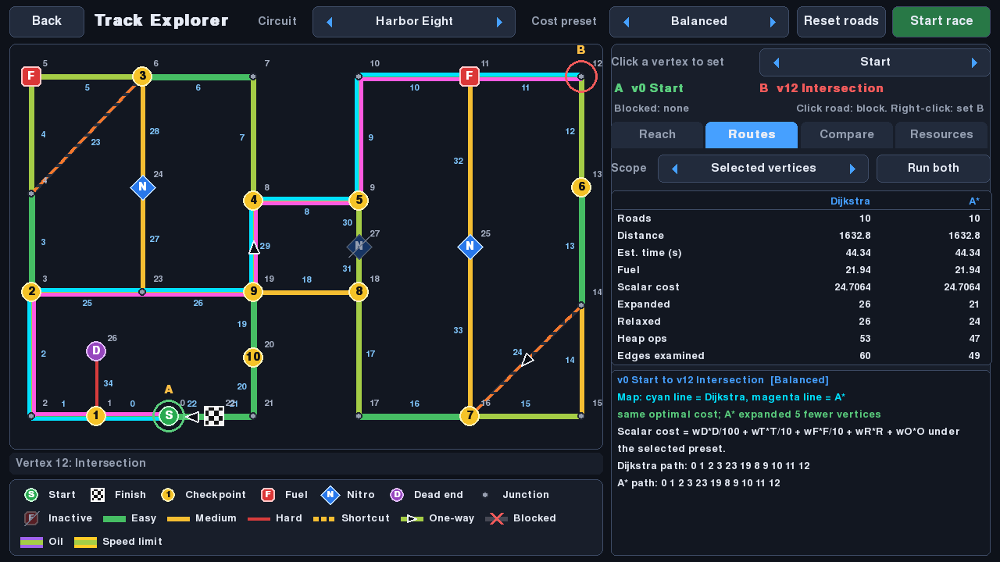
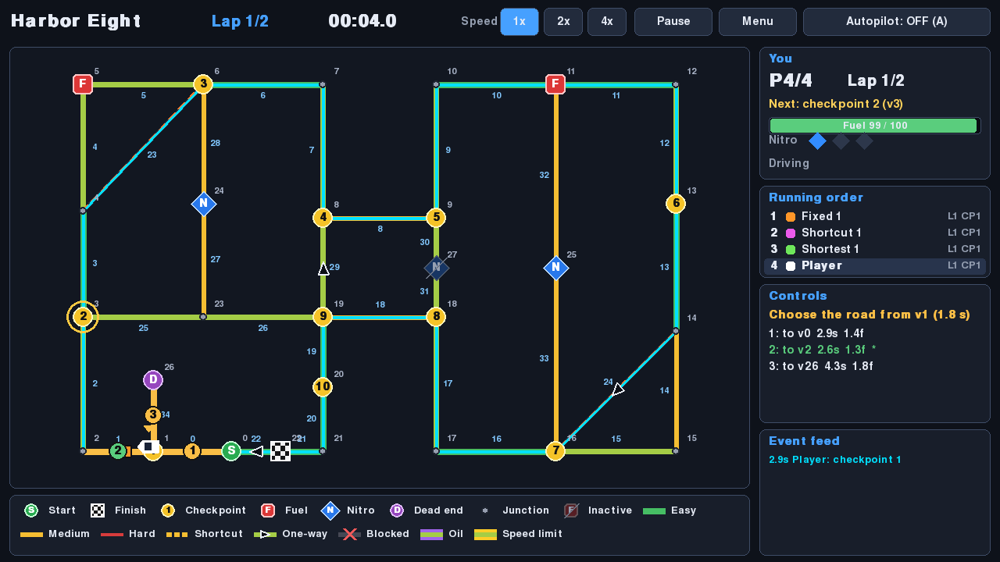
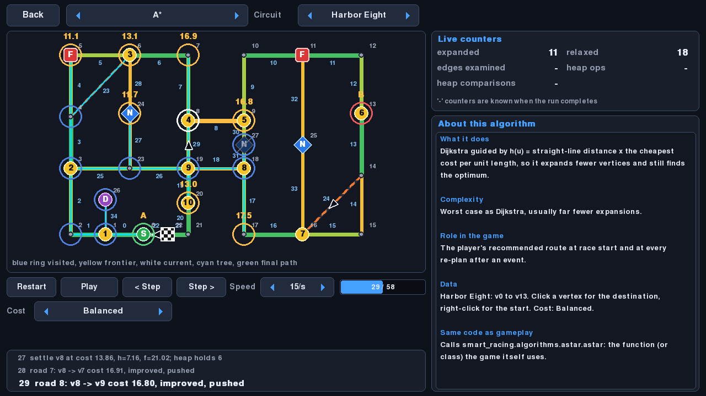
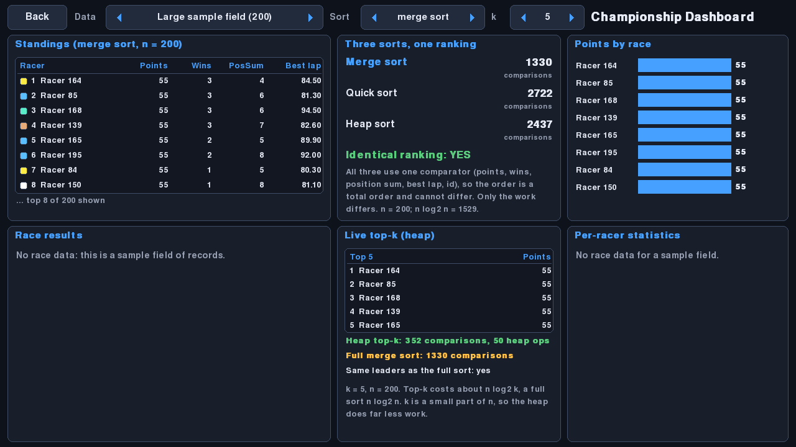
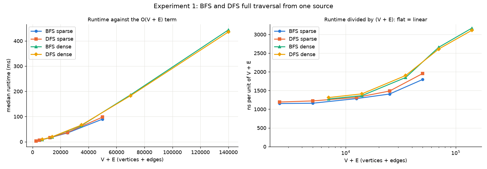
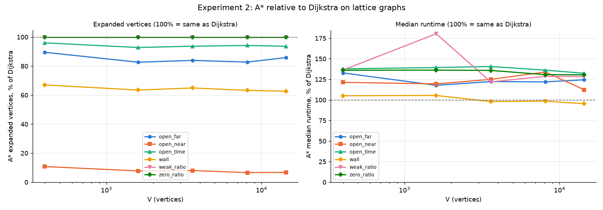
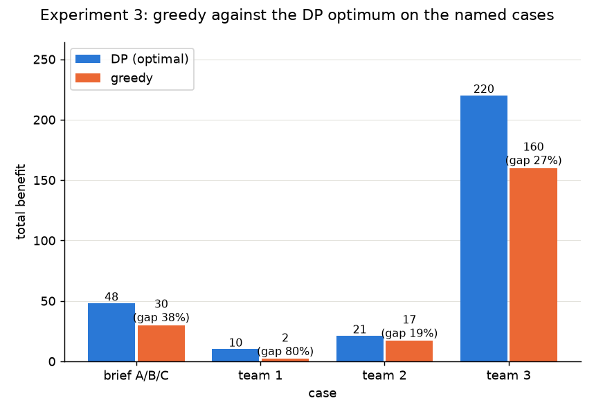
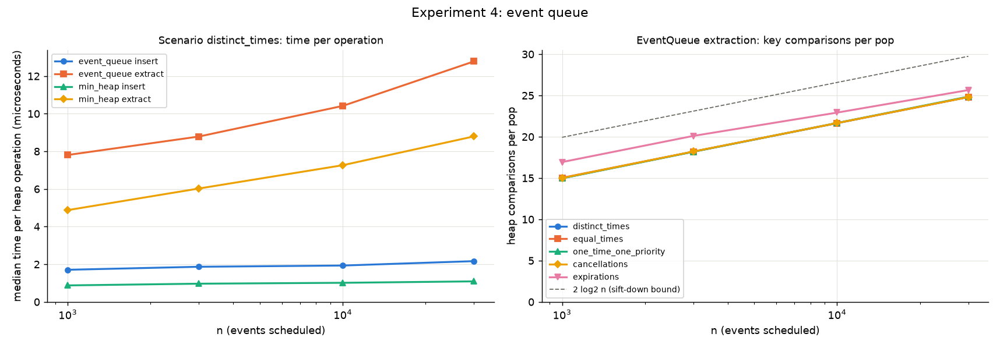
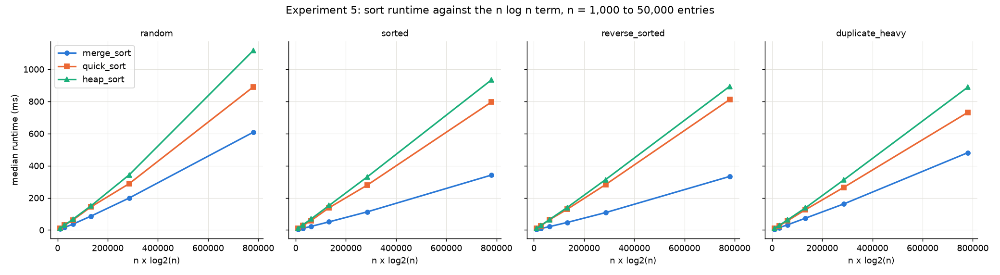
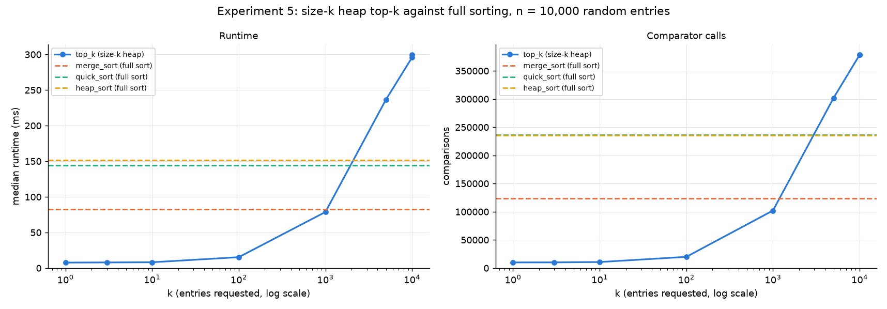

**Course:** Design and Analysis of Algorithms  **Section:** X
**Group members:** 24I-XXXX Name, 24I-YYYY Name, 24I-ZZZZ Name *(placeholders: replace before submission)*
**Deadline:** 05 December 2026

# 1. Title and summary

Smart Racing Championship is a 2D top-down racing game in Python (pygame-ce) whose gameplay is driven by twelve hand-written algorithms. The assessment focus is modelling, algorithm integration, complexity, testing and measured results. No machine learning is used; opponents follow fixed deterministic rules.

# 2. Introduction and problem statement

Circuits are road networks with checkpoints, shortcuts, fuel stations, nitro pickups and dynamic events. The player plans routes, manages fuel and nitro, reacts to road closures, and competes against three deterministic opponents over a three-race championship. Every mandatory algorithm has a functional role in the running game, and the Algorithm Lab replays the same implementations gameplay calls.

# 3. System architecture and game flow

```
ui (pygame)  ->  engine (headless)  ->  algorithms  ->  core
 screens          race, routing,         bfs dfs dijkstra   graph, models,
 lab registry     resources, opponents   astar knapsack      cost
                  events, championship   refuel mst
 tracks: loader, validator, generator    backtracking sorting topk heap
```

`core`, `algorithms` and `engine` never import pygame, so a full championship runs headless and deterministically (fixed tick `SIM_DT = 0.05 s`, seeded randomness, id-based tie-breaks). Flow: Main Menu -> Championship / Quick Race / Track Explorer / Algorithm Lab / Dashboard / Track Generator. In a championship: briefing -> plan (BFS/DFS explore, Dijkstra/A* compare, DP/greedy recommend) -> race (event heap, rerouting) -> results -> standings (sorting, top-k) -> repeat for three circuits -> champion.

The five required screens are: Main Menu, Track Explorer / Route Planner, Racing Screen, Algorithm Lab, Championship Dashboard. A Track Generator screen covers Challenge 1.

{width=95%}

{width=95%}

{width=95%}

{width=95%}

# 4. Data models, assumptions, cost and rules

**Graph.** `TrackGraph` uses adjacency lists: O(V+E) memory and efficient neighbour iteration for sparse roads. Vertices: id, x, y, type, checkpoint order, active. Edges: id, endpoints, distance, base time, fuel cost, difficulty 1 to 5, shortcut flag, directed flag, and a set of independent temporary effects. Blocking, unblocking and station activation are in-place updates. Blocked edges and wrong-way one-way edges are never yielded by `neighbors`. Overlapping effects (block, oil, speed restriction) are stored per event id: difficulty bump is the maximum, time multiplier the strictest, and expiry of one effect never removes another.

**Cost.** `cost(e) = wD*D/Dref + wT*T/Tref + wF*F/Fref + wR*R + wO*O` with `Dref=100, Tref=10, Fref=10`, `R=(difficulty-1)/4`, `O` the obstacle penalty in [0,1]. The displayed cost is exactly the cost optimised.

| Preset | wD | wT | wF | wR | wO |
|---|---|---|---|---|---|
| Balanced | 1 | 1 | 1 | 1 | 1 |
| Speed | 0.5 | 3 | 0.25 | 0.5 | 0.5 |
| Economy | 0.5 | 0.5 | 3 | 0.5 | 0.5 |
| Safety | 0.5 | 0.5 | 0.5 | 3 | 3 |

**Rules (frozen in `docs/SPEC.md`, `docs/RULES.md`).** Tank 100, fuel per edge = `fuelCost * (1 + 0.1*(difficulty-1))`; stations sell up to 40 units for a fixed 3 s stop; nitro max 3 charges, 1.5x speed for 4 s with 2x fuel; laps need all checkpoints in order and a finish crossing; ties by lower racer id; unfinished racers rank by laps, checkpoints, time, id and earn no points. Points 25, 18, 15, 12, 10, 8, 6, 4, 2, 1 plus a fastest-lap bonus of 1 for finishers. Championship comparator: points, wins, lower position sum, lower best lap, lower racer id (single function `championship_less`). Recovery policy: re-plan, wait, DNF after 60 s waiting or immediately when no pending event can change the graph.

**Opponents.** Fixed Route (stored main route and detour), Shortcut (uses a designated shortcut when open, else main route), Shortest Distance (recomputes minimum distance). Each refuels when below 25% fuel or when fuel will not reach the next station; documented in `docs/RULES.md` as a deliberate extension because the bare 25% rule stranded cars.

**Circuits.** Harbor Eight (28 vertices, 35 edges), Grand Ring (25/33), Serpent Pass (31/38); each has 10 ordered checkpoints, 2 shortcuts, a cycle, a dead end, one-way roads, fuel stations and nitro pickups.

# 5. Algorithm design

Each function returns a result dataclass with operation counters and accepts an optional `observer` callback; the Lab replays those steps. Supporting data structures (MinHeap, union-find, queue) are distinguished from algorithms.

| # | Algorithm | Pseudocode (core idea) | Time / space |
|---|---|---|---|
| 1 | BFS | queue; pop u; for each traversable neighbour v unseen: parent[v]=u, push | O(V+E) / O(V) |
| 2 | DFS | explicit stack; discovery order, back-edge detection for cycles, components, dead-end analysis; bounded path enumeration (max 10 routes, 40 edges) | O(V+E) / O(V); path enumeration exponential, hence limits |
| 3 | Dijkstra | heap on (dist, id); pop, skip stale, relax out-edges with non-negative cost | O((V+E) log V) / O(V) |
| 4 | A* | Dijkstra with key g+h, h = straight-line distance x min cost-per-distance ratio | worst case as Dijkstra |
| 5 | DP | knapsack `dp[i][b] = max(dp[i-1][b], dp[i-1][b-c_i]+v_i)` with traceback; refuel DP over (stop, fuel) minimising stop time | O(mB), O(mC^2) |
| 6 | Greedy | zero-cost positive-benefit first, then by v/c descending, ties by id; not optimal | O(m log m) |
| 7 | Backtracking | assign variables in order, reject inconsistent values, optional prune hook, node limit | exponential worst case |
| 8 | Kruskal | merge-sort edges by (weight, id); union-find accepts edge if endpoints differ | O(E log E) |
| 9 | Heap / PQ | binary min-heap keyed (time, priority, sequence); size-k heap for top-k | O(log n) push/pop, O(n log k) top-k |
| 10 | Merge sort | bottom-up, stable | O(n log n) / O(n) |
| 11 | Quick sort | median-of-three at seeded pseudo-random positions, three-way partition, explicit stack | O(n log n) avg, O(n^2) worst |
| 12 | Heap sort | build heap, extract | O(n log n), in place, not stable |

**Pseudocode.**

1. **BFS(G, s, t):** (1) dist[s]=0, enqueue s. (2) While the queue is non-empty, dequeue u; stop if u==t. (3) For each traversable edge (u,v) with v unseen: dist[v]=dist[u]+1, parent[v]=(u,e), enqueue v. (4) Rebuild the path from parent. O(V+E).
2. **DFS (explicit stack):** (1) Push s and mark discovery. (2) For each neighbour v of the top vertex: if unseen, set parent and push; else if v is not reached by the parent edge, record a back edge (cycle). (3) Components: restart from every unvisited vertex. (4) Dead ends: DFS over (arrival edge, vertex) states from Start and a reverse search from Finish; a non-mandatory reachable vertex with no arrival state that reaches Finish is a dead end. (5) `enumerate_paths`: depth-first over simple paths, cut at `max_routes` and `max_length`.
3. **Dijkstra(G, s, cost):** (1) dist[s]=0, push (0,s). (2) Pop (d,u); skip if d>dist[u]. (3) For each open edge e=(u,v): if d+cost(e)<dist[v], update dist and parent, push. (4) Stop when the target is closed. O((V+E) log V), cost >= 0.
4. **A\*:** (1) r = min over open edges of cost(e)/straight_line(e); h(v)=straight_line(v,t)*r. (2) Run Dijkstra with key g+h, ties by vertex id. (3) h is admissible and consistent, so a closed vertex is never reopened; if r=0 this is Dijkstra.
5. **Knapsack DP:** (1) dp[0][b]=0. (2) For i=1..m, b=0..B: dp[i][b]=dp[i-1][b]; if c_i<=b and dp[i-1][b-c_i]+v_i is strictly larger, take it. (3) Traceback from b=B: for i=m..1, if dp[i][b]!=dp[i-1][b], select i and b-=c_i. O(mB). The refuel DP is written out below.
6. **Greedy:** (1) Drop items with benefit <= 0. (2) Take zero-cost positive-benefit items first, in id order. (3) Sort the rest by v/c descending (cross-multiplied), ties by lower id. (4) Scan in order; take an item if it fits, otherwise skip it and continue. O(m log m).
7. **Backtracking(i):** (1) If i==n, return the solution. (2) For each value x in domain(i): if consistent(x) and not pruned, assign it and recurse on i+1; return if solved. (3) Undo and try the next value. (4) Stop at the node limit. Exponential worst case.
8. **Kruskal:** (1) Merge-sort edges by (weight, id). (2) For each edge (u,v): if find(u)!=find(v), union and keep it. (3) If fewer than V-1 edges were kept, report a forest. O(E log E).
9. **Event queue (MinHeap, key (time, priority, seq)):** schedule pushes with the next sequence number; cancel sets `cancelled=True`; `pop_due(now)` pops while top time <= now, skips cancelled entries, validates the target and state (apply or log as rejected) and schedules an expiry for temporary effects; the engine then re-plans once per affected racer. Top-k: a size-k heap whose root is the worst kept entry is replaced when a better entry arrives, O(n log k).
10. **Merge sort:** (1) Treat runs of width 1 as sorted. (2) Merge adjacent runs, taking from the left run on ties (stable). (3) Double the width until it reaches n. O(n log n), O(n) extra.
11. **Quick sort (explicit stack):** (1) Pivot = median of three elements at seeded pseudo-random positions. (2) Three-way partition `< | == | >`. (3) Push the two outer ranges. Average O(n log n), worst case O(n^2).
12. **Heap sort:** (1) Build a heap in place bottom-up. (2) Swap root with the last element, shrink the heap, sift down. (3) Repeat n-1 times. O(n log n), in place, not stable.

**Cost normalisation rationale.** Each term is divided by a reference so it is dimensionless (`D/100`, `T/10`, `F/10`); `R=(difficulty-1)/4` and `O` already lie in [0,1]. The references are round numbers near the upper range of the built-in edges (distance 57 to 316, median 177; time 1.3 to 9.6, median 4.2; fuel 0.8 to 13, median 2.7), so no term is switched off by its unit. Balanced uses weight 1 everywhere; the presets tilt it (Speed wT=3, wF=0.25; Economy wF=3; Safety wR=wO=3). All weights are >= 0, so edge costs are >= 0 and Dijkstra applies. The displayed cost is computed by the same function the search minimises. Limit: the winning route depends on the references and weights, and a weighted sum can miss Pareto-optimal routes.

**Knapsack DP (Problem A).** Items i=1..m with integer cost c_i >= 0 (extra out-and-back detour time in tenths of a second, rounded up) and benefit v_i; budget B = 6 s = 60 units. Only detour time is budgeted; nitro capacity is applied before the knapsack and fuel is checked afterwards by the refuel DP, which drops the thirstiest loop while the plan is infeasible. *State:* `dp[i][b]` = best benefit using the first i items with total cost <= b. *Base:* `dp[0][b]=0`; for positive costs `dp[i][0]=0`. *Recurrence:* `dp[i][b]=max(dp[i-1][b], dp[i-1][b-c_i]+v_i)` if c_i <= b, else `dp[i-1][b]`; an item is taken only on strict improvement (deterministic). *Reconstruction:* from (m,B), item i was taken iff `dp[i][b]!=dp[i-1][b]`, then b-=c_i. *Complexity:* O(mB) time and space (O(B) if only the value is needed), pseudo-polynomial in the numeric budget. Zero-cost items fit every column; greedy takes zero-cost positive-benefit items first.

**Refuel DP (Problem B).** A fixed route has stops 0..m-1 plus destination m; d_j is the fuel from stop j to j+1; C is the tank capacity. The fuel unit is 1/`FUEL_SCALE` = 0.1: demands round up, start fuel and capacity round down, and purchases are whole units, so a DP-feasible plan is feasible in the engine (the state space is 10x larger than with whole units). *State:* `dp[j][f]` = minimum stop time to arrive at stop j with f units. *Base:* `dp[0][start_fuel]=0`; other states are unreachable and skipped. *Transition* at an available stop j: buy a with 0 <= a <= min(40, C-f); if f+a >= d_j, `dp[j+1][f+a-d_j] = min(., dp[j][f] + (3 s if a>0 else 0))`; at a non-station or the destination only a=0. *Answer:* the destination state with least stop time, ties by most fuel; infeasible if no state reaches m, and the first leg no state can cover is reported. *Reconstruction:* a parent (f, a) is stored per state and followed back; `replay_plan` re-checks the rules independently. *Complexity:* O(m * F * P) with F = C*scale+1 fuel states and P = 41 purchase options (the brief's O(mC^2) in scaled units); space O(mF).

**Backtracking: worst case and pruning.** With n variables and domain size d, up to O(d^n) assignments can be tried; placing checkpoints, stations and pickups on a loop is exponential without pruning. The search is bounded by a node limit and the 20-attempt retry limit, so an over-hard candidate is retried or rejected rather than hanging. Each pruning rule below is a necessary condition of a valid track, not a preference, so it never discards a valid layout: (1) maximum degree: a shortcut endpoint already at `GEN_MAX_DEGREE` roads is refused; (2) station spacing: stations must be at least `GEN_STATION_MIN_GAP` loop positions apart in both directions; (3) obstacle spacing: two obstacle sites may not share an endpoint; (4) critical bridge: no closure is scripted on a bridge, found by blocking the road and counting DFS components, since it would cut racers off; (5) shortcut separation: the second shortcut starts after the first ends, removing symmetric orderings; (6) checkpoint order and room: checkpoint k goes after k-1, never on a station or shortcut-cut vertex, and a branch is cut when fewer free later positions remain than checkpoints left to place; (7) nitro spacing: pickups at least `GEN_NITRO_MIN_HOPS` apart and off mandatory, station and dead-end vertices; (8) loop closure: a branch is cut when the start vertex is more roads away than slots remain (BFS hops are a lower bound). The counters `nodes`, `prunes` and `backtracks` are reported.

**Correctness reasoning.** BFS dequeues vertices in non-decreasing edge-count order, so the first discovery of a vertex is by a minimum-edge path (it ignores weights: direct S-T of length 10 beats S-A-B-T of length 6 in edges but not in distance). Dijkstra's closed-set invariant holds because costs are non-negative. The A* heuristic multiplies straight-line distance by the minimum cost-per-distance ratio over open edges; by the triangle inequality it is admissible and consistent, so closed vertices are never reopened and the cost equals Dijkstra's (verified on 400 random instances). Knapsack DP is checked against exhaustive search on 200 random instances in the unit tests and 500 in the Experiment 3 sweep; greedy is shown suboptimal (the brief's A/B/C example gives 30 versus 48, plus three further cases (two original team cases and the textbook 10/20/30 case)). Event order is by `(trigger_time, priority, insertion_sequence)` with lazy deletion for cancellation: simple and O(1) to cancel, at the cost of cancelled entries staying in memory until popped. Prim vs Kruskal: Kruskal implemented; the candidate graph must be connected, otherwise the result is a forest and is reported as such.

**Generation pipeline (Challenge 1).** Jittered lattice vertices, candidate roads, Kruskal MST, extra edges, a backtracking search for a closed main loop, one-way roads added after the MST, backtracking placement of checkpoints, stations, pickups and obstacles under documented pruning rules, then validation with up to 20 retries. Seed 29 shows attempt 1 rejected for fuel infeasibility and attempt 2 accepted.

# 6. Integration: where each algorithm runs in gameplay

| # | Algorithm | Call sites |
|---|---|---|
| 1 | BFS | validator (ordered reachability, lap return), generator, Track Explorer, Lab |
| 2 | DFS | validator (cycle, dead end, two routes), generator (bridges), Explorer, Lab |
| 3 | Dijkstra | Opponent 3 routes, nearest-station recovery, pickup detours, validator, Explorer |
| 4 | A* | player route at start and every re-plan, preset comparison, Explorer |
| 5 | DP | pickup recommendation (knapsack), refuel plan at stations, validator fuel check |
| 6 | Greedy | pickup planner. Quick Race has a 'Pickup planner' setting (DP, greedy, none) that the player's autopilot applies; the Racing Screen shows the DP and greedy benefits of the current plan side by side, and the Explorer resource tab shows the same comparison before the race |
| 7 | Backtracking | track generator (main loop, placement) |
| 8 | Kruskal | track generator backbone |
| 9 | Heap | event queue in the race loop, search frontiers, live top-k |
| 10 | Merge sort | championship standings (default), live running order |
| 11 | Quick sort | selectable standings method on Dashboard |
| 12 | Heap sort | selectable standings method on Dashboard |

The Algorithm Lab obtains every algorithm from `smart_racing.ui.lab_registry`, which holds the same function objects gameplay imports. Test `test_registry_is_the_gameplay_functions` asserts identity, and `test_lab_counters_equal_direct_call` asserts the Lab's counters equal a direct call. BFS and DFS are not called inside the per-tick race loop; they run in the validator, generator, Explorer, Lab and the championship briefing (BFS: reachable checkpoints and fewest roads Start to Finish; DFS: cycle and dead ends of the circuit about to be raced).

# 7. Testing

The full suite has 383 passing tests (`.venv/bin/pytest -q`). Coverage mapped to Project.md 9.1:

| Area | Test files |
|---|---|
| Graph: single vertex, disconnected, cyclic, branching, dead end, directed, undirected | `test_graph.py`, `test_bfs_dfs.py` |
| Routing: source=target, unreachable, blocked edge, equal cost, zero weight, changes mid-race | `test_shortest_path.py`, `test_routing_resources.py`, `test_race.py` |
| Resources: insufficient fuel, full tank, unavailable station, capacity, zero-cost pickup, infeasible plan | `test_refuel.py`, `test_knapsack.py`, `test_routing_resources.py` |
| Events: simultaneous, ties, cancellation, expiry, missing target, overlap | `test_events.py`, `test_heap.py` |
| Sorting: empty, singleton, random, sorted, reversed, duplicates, same comparator, id tie-break | `test_sorting_topk.py` |
| Tracks and generator: validator rejections, minimum counts, seeds | `test_tracks.py`, `test_generator.py`, `test_mst.py`, `test_backtracking.py` |
| Integration: full race, laps, ordered checkpoints, DNF, closure, championship | `test_race.py`, `test_championship.py` |
| GUI: every screen, full championship from menu, registry identity | `test_ui_smoke.py`, `test_ui_phase6.py` |
| Experiments: correctness conditions | `test_experiments.py` |

Dijkstra and A* are checked against brute force on 40 seeded random graphs; DP against exhaustive search; Kruskal weight against brute-force MST on 150 graphs; the three sorts agree on every input shape, including 100k elements with a low recursion limit.

# 8. Experiments

Five studies follow the required format: objective, environment, input generation, dataset sizes, procedure, metrics, results, interpretation, limitations, conclusion. Full detail, tables and raw-data pointers are in **Appendix A** (generated from the CSV files in `experiments/results/`). Headline findings from the final run:

- **Exp 1 BFS/DFS:** counters are exactly linear (V vertices visited, 2E adjacency entries examined); measured runtime grew faster than V+E on the large inputs, so the measurements do not by themselves confirm linear time; theory gives O(V+E).
- **Exp 2 Dijkstra/A\*:** equal costs in all 50 timed configurations and 400 sweep instances; A* expanded fewer vertices in 40 timed configurations, equal in 10, more in none; in wall time A* was usually slower on the small real circuits (25 to 31 vertices).
- **Exp 3 DP/greedy:** DP equals exhaustive search in all instances; greedy strictly worse on the brief's example (30 vs 48) and on three team cases; greedy suboptimal in 151 of 500 random instances.
- **Exp 4 event queue:** pop order correct for ties, cancellations and expirations; 15.0 comparisons per pop at n=1,000 and 24.8 at n=30,000.
- **Exp 5 sorting/top-k:** all sorts agree with the common comparator; merge sort fastest on every shape (609 ms at n=50,000 random vs 891 ms quick and 1,117 ms heap); size-k top-k beats full sort for small k and loses for k near n.

{width=70%}

{width=70%}

{width=70%}

{width=70%}

{width=70%}

{width=70%}

# 9. Limitations, advanced challenges, future work

**Advanced challenges (all three completed).** Challenge 1 automatic generation: Track Generator screen and `tracks/generator.py`, with rejected candidates and reasons (seed 29). Challenge 2 multi-objective planning: Explorer Compare tab with the four presets, weights table and the limitation that a single weighted scalar depends on arbitrary weights and normalisation and can miss Pareto-optimal routes. Challenge 3 live analytics: heap-based top-k in the Dashboard and Racing Screen compared with full sorting.

**Limitations.** A* is slower than Dijkstra in wall time on the small circuits despite expanding fewer vertices. Greedy is not optimal. Generated tracks are valid but less race-like than the hand-built ones. The generator view draws only the accepted attempt. The Lab's heap-sort view shows the unsorted part in input order because the observer does not record the heap array. The Lab's backtracking example is station spacing rather than the generator's own placement problem. Settings are not persisted. Opponent cars are distinguished by colour only. Timings come from one machine and Python; they are not a general statement about the algorithms.

**Future work.** Per-attempt drawings in the generator, persistent settings, an on-car label, and a compiled implementation for larger timing ranges.

# 10. Conclusion

All twelve mandatory algorithm families are implemented by hand, integrated into a deterministic playable game, visualised through the same code in the Algorithm Lab, covered by 383 tests, and measured in five reproducible experiments. All three advanced challenges are included.

**References and acknowledgements.** pygame-ce (GUI), matplotlib (charts), pytest (tests), pandoc and Chrome (report export), and course lecture material. No external code was copied; no assets were used (all graphics are drawn with pygame primitives).

# Compliance checklist (Project.md sections 1 to 9)

| Requirement | Where satisfied |
|---|---|
| 3 playable circuits, 10 checkpoints, 2 shortcuts, cycle, dead end, one-way | `smart_racing/tracks/data/*.json`, `test_tracks.py` |
| 1 human + at least 3 opponents, deterministic | `engine/opponents.py`, `test_race.py` |
| 5 GUI screens | `ui/screens/` (menu, explorer, race, lab, dashboard) |
| 12 algorithm families | `smart_racing/algorithms/`, section 6 |
| Lab uses gameplay code | `ui/lab_registry.py`, `test_ui_phase6.py` |
| Cost normalisation, presets, different routes per preset | `core/cost.py`, section 4, `test_tracks.py` |
| Event heap, lazy cancel, overlapping effects | `engine/events.py`, `test_events.py` |
| Scoring and single comparator | `engine/championship.py`, `algorithms/sorting.py` |
| 5 experiments with raw data | `experiments/results/`, Appendix A |
| 3 advanced challenges | section 9 |
| README, report PDF, ZIP | `README.md`, `report/report.pdf`, `scripts/package.py` |

\newpage

# Appendix A. Experimental results (generated)

*The text below is generated by `python -m smart_racing.experiments.run_all` from the raw CSV files and is included unmodified.*

## Overview

Generated by `.venv/bin/python -m smart_racing.experiments.run_all` on 2026-11-17T14:18:47.
Every number below is computed from the CSV files in this directory by the experiment scripts;
rerunning regenerates this file, the CSVs and the charts. 

Common method (Project.md section 7, fair timing):

- The experiments call the gameplay implementations in `smart_racing/algorithms/` and
  `smart_racing/engine/events.py` and read their built-in counters. There is no second copy.
- Inputs are generated from seeded `random.Random` instances (base seed 2026); competing
  algorithms receive the same input instance.
- Each configuration: 1 untimed warm-up call, then 5 timed calls with `time.perf_counter`,
  all in one process on one machine. The garbage collector is run once before each
  configuration and disabled during each timed call. Observers are off. No rendering, file output or artificial delay is
  inside a timed call; input construction and correctness checks are outside.
- Whether data-structure initialization is included is stated in each Procedure paragraph. In
  short: the structures an algorithm creates for itself (queue, heap, visited and parent
  dictionaries, DP table, output list) are included; building the input (graph, item list,
  entry list, a pre-filled event queue) is excluded.
- `*_raw.csv` holds every timed run; `*_summary.csv` holds runs, mean, median and sample
  standard deviation per configuration. Tables below show medians unless a column says otherwise.
- Counters are deterministic and identical across runs. Timings are wall-clock measurements on
  one machine and vary between runs; no complexity class is inferred from a single timing.
  Statements about growth compare several sizes and are stated as consistent with a bound, not
  as proof of it.

Wall time of this run: exp1_bfs_dfs 25 s, exp2_shortest_path 27 s, exp3_knapsack 12 s, exp4_event_queue 34 s, exp5_sorting_topk 102 s.

### Experiment 1: BFS and DFS

**Objective.** Measure how the gameplay BFS (`algorithms/bfs.py: bfs`) and DFS
(`algorithms/dfs.py: dfs`, `connected_components`, `find_cycle`) grow with graph size on
sparse and denser graphs, and compare with the O(V + E) bound.

**Environment.** 12th Gen Intel(R) Core(TM) i3-1215U, 8 logical CPUs, 15.3 GB RAM, Linux-7.0.0-43-generic-x86_64-with-glibc2.39, CPython 3.12.3, one process and one thread. Timer `time.perf_counter`; 1 warm-up call then 5 timed calls per configuration; garbage collector run once before each configuration and disabled during each timed call; base seed 2026. Full record: `environment.json`.

**Input generation.** `common.random_graph(V, extra, seed=2026 + V, components)`: V random
points in a 1000 x 1000 square; vertex i belongs to block i mod components; each block is joined
by a random tree and then receives random extra two-way roads. Edge distance = straight line x
U(1.0, 1.3). Families: sparse (0.5 V extra roads, E about 1.5 V), dense (5 V extra roads, E about
6 V), forest (8 trees, no extra road, E = V - 8).

**Dataset sizes.** V in [1000, 2000, 5000, 10000, 20000]; E from 992 to 119,999.

**Procedure.** For each graph: BFS without a target from vertex 0, DFS from vertex 0, connected
components, and cycle detection, each timed as described above. The timed call includes the
algorithm's own initialization (result record, visited/parent dictionaries, queue or stack);
building the graph is excluded. Checks run after timing: (1) BFS distances pass an optimality
certificate (source 0, no road joins levels more than one apart, every vertex has a neighbour one
level closer); (2) they equal the distances of Dijkstra with unit edge cost; (3) the BFS path to
the farthest vertex is a real path of that many edges; (4) DFS visits exactly the source's block;
(5) the component count and member lists equal the construction; (6) `find_cycle` reports a cycle
exactly when extra roads were added and the reported walk is closed and uses existing roads.
All checks passed for every graph.

**Metrics.** Runtime (ms; mean, median, standard deviation over 5 runs), visited vertices,
examined edges (adjacency entries read).

**Results.** Raw runs: `exp1_raw.csv`; aggregates: `exp1_summary.csv`; chart: `exp1_runtime.png`.

| family | V | E | algorithm | visited | edges_examined | mean_ms | median_ms | stdev_ms | ns_per_V_plus_E |
|---|---|---|---|---|---|---|---|---|---|
| sparse | 1,000 | 1,499 | bfs | 1,000 | 2,998 | 2.837 | 2.880 | 0.125 | 1,152.3 |
| sparse | 1,000 | 1,499 | dfs | 1,000 | 2,998 | 3.075 | 2.981 | 0.341 | 1,192.8 |
| sparse | 1,000 | 1,499 | components | 1,000 | 2,998 | 4.292 | 4.306 | 0.292 | 1,722.9 |
| sparse | 2,000 | 2,999 | bfs | 2,000 | 5,998 | 5.950 | 5.803 | 0.580 | 1,160.7 |
| sparse | 2,000 | 2,999 | dfs | 2,000 | 5,998 | 6.146 | 6.109 | 0.074 | 1,222.1 |
| sparse | 2,000 | 2,999 | components | 2,000 | 5,998 | 4.994 | 5.067 | 0.135 | 1,013.6 |
| sparse | 5,000 | 7,499 | bfs | 5,000 | 14,998 | 16.324 | 16.051 | 0.635 | 1,284.2 |
| sparse | 5,000 | 7,499 | dfs | 5,000 | 14,998 | 16.430 | 16.435 | 0.176 | 1,314.9 |
| sparse | 5,000 | 7,499 | components | 5,000 | 14,998 | 13.753 | 13.813 | 0.222 | 1,105.1 |
| sparse | 10,000 | 14,999 | bfs | 10,000 | 29,998 | 34.994 | 35.162 | 0.630 | 1,406.5 |
| sparse | 10,000 | 14,999 | dfs | 10,000 | 29,998 | 42.092 | 37.148 | 8.606 | 1,486.0 |
| sparse | 10,000 | 14,999 | components | 10,000 | 29,998 | 28.188 | 28.262 | 0.377 | 1,130.5 |
| sparse | 20,000 | 29,999 | bfs | 20,000 | 59,998 | 100.6 | 89.776 | 22.850 | 1,795.6 |
| sparse | 20,000 | 29,999 | dfs | 20,000 | 59,998 | 97.405 | 97.764 | 8.835 | 1,955.3 |
| sparse | 20,000 | 29,999 | components | 20,000 | 59,998 | 77.127 | 75.409 | 3.480 | 1,508.2 |
| dense | 1,000 | 5,999 | bfs | 1,000 | 11,998 | 8.932 | 8.918 | 0.096 | 1,274.2 |
| dense | 1,000 | 5,999 | dfs | 1,000 | 11,998 | 9.214 | 9.188 | 0.061 | 1,312.8 |
| dense | 1,000 | 5,999 | components | 1,000 | 11,998 | 7.774 | 7.789 | 0.050 | 1,112.9 |
| dense | 2,000 | 11,999 | bfs | 2,000 | 23,998 | 19.055 | 19.080 | 0.235 | 1,363.0 |
| dense | 2,000 | 11,999 | dfs | 2,000 | 23,998 | 19.791 | 19.749 | 0.240 | 1,410.7 |
| dense | 2,000 | 11,999 | components | 2,000 | 23,998 | 16.407 | 16.432 | 0.178 | 1,173.8 |
| dense | 5,000 | 29,999 | bfs | 5,000 | 59,998 | 66.023 | 64.681 | 3.300 | 1,848.1 |
| dense | 5,000 | 29,999 | dfs | 5,000 | 59,998 | 70.278 | 66.541 | 6.348 | 1,901.2 |
| dense | 5,000 | 29,999 | components | 5,000 | 59,998 | 65.021 | 61.233 | 8.240 | 1,749.6 |
| dense | 10,000 | 59,999 | bfs | 10,000 | 119,998 | 187.2 | 186.0 | 6.985 | 2,656.8 |
| dense | 10,000 | 59,999 | dfs | 10,000 | 119,998 | 193.2 | 182.7 | 31.313 | 2,610.0 |
| dense | 10,000 | 59,999 | components | 10,000 | 119,998 | 169.7 | 170.7 | 16.893 | 2,438.5 |
| dense | 20,000 | 119,999 | bfs | 20,000 | 239,998 | 464.1 | 443.6 | 46.419 | 3,168.9 |
| dense | 20,000 | 119,999 | dfs | 20,000 | 239,998 | 436.4 | 435.6 | 9.849 | 3,111.5 |
| dense | 20,000 | 119,999 | components | 20,000 | 239,998 | 397.9 | 397.9 | 16.170 | 2,842.3 |
| forest | 1,000 | 992 | bfs | 125 | 248 | 0.281 | 0.276 | 0.021 | 138.3 |
| forest | 1,000 | 992 | dfs | 125 | 248 | 0.286 | 0.281 | 0.019 | 141.0 |
| forest | 1,000 | 992 | components | 1,000 | 1,984 | 1.646 | 1.624 | 0.041 | 815.3 |
| forest | 2,000 | 1,992 | bfs | 250 | 498 | 0.721 | 0.634 | 0.171 | 158.9 |
| forest | 2,000 | 1,992 | dfs | 250 | 498 | 0.560 | 0.547 | 0.043 | 137.0 |
| forest | 2,000 | 1,992 | components | 2,000 | 3,984 | 3.364 | 3.345 | 0.032 | 837.9 |
| forest | 5,000 | 4,992 | bfs | 625 | 1,248 | 1.390 | 1.329 | 0.172 | 133.0 |
| forest | 5,000 | 4,992 | dfs | 625 | 1,248 | 1.407 | 1.343 | 0.120 | 134.5 |
| forest | 5,000 | 4,992 | components | 5,000 | 9,984 | 8.942 | 8.927 | 0.034 | 893.4 |
| forest | 10,000 | 9,992 | bfs | 1,250 | 2,498 | 2.822 | 2.760 | 0.146 | 138.1 |
| forest | 10,000 | 9,992 | dfs | 1,250 | 2,498 | 2.944 | 2.859 | 0.207 | 143.0 |
| forest | 10,000 | 9,992 | components | 10,000 | 19,984 | 19.417 | 19.446 | 0.090 | 972.7 |
| forest | 20,000 | 19,992 | bfs | 2,500 | 4,998 | 9.003 | 8.980 | 1.041 | 224.6 |
| forest | 20,000 | 19,992 | dfs | 2,500 | 4,998 | 8.184 | 8.144 | 0.320 | 203.6 |
| forest | 20,000 | 19,992 | components | 20,000 | 39,984 | 45.826 | 44.903 | 2.477 | 1,122.8 |

Cycle detection (stops at the first cycle, so it only scans everything on the forest):

| family | V | E | visited | edges_examined | median_ms |
|---|---|---|---|---|---|
| sparse | 1,000 | 1,499 | 14 | 21 | 0.064 |
| sparse | 2,000 | 2,999 | 20 | 34 | 0.135 |
| sparse | 5,000 | 7,499 | 14 | 21 | 0.098 |
| sparse | 10,000 | 14,999 | 22 | 34 | 0.236 |
| sparse | 20,000 | 29,999 | 17 | 30 | 0.514 |
| dense | 1,000 | 5,999 | 14 | 21 | 0.045 |
| dense | 2,000 | 11,999 | 20 | 34 | 0.072 |
| dense | 5,000 | 29,999 | 13 | 18 | 0.100 |
| dense | 10,000 | 59,999 | 22 | 34 | 0.240 |
| dense | 20,000 | 119,999 | 17 | 30 | 0.573 |
| forest | 1,000 | 992 | 1,000 | 1,984 | 2.320 |
| forest | 2,000 | 1,992 | 2,000 | 3,984 | 4.807 |
| forest | 5,000 | 4,992 | 5,000 | 9,984 | 12.679 |
| forest | 10,000 | 9,992 | 10,000 | 19,984 | 28.106 |
| forest | 20,000 | 19,992 | 20,000 | 39,984 | 65.513 |

**Interpretation.** On a connected two-way graph BFS and DFS each visited V vertices and examined
exactly 2E adjacency entries (each road is seen from both ends), which is the V + E work the
bound counts. Measured growth:

- bfs on sparse: V+E grew 20.0x (2,499 to 49,999), median time grew 31.2x (2.880 ms to 89.78 ms); time per unit of V+E between 1152 and 1796 ns.
- dfs on sparse: V+E grew 20.0x (2,499 to 49,999), median time grew 32.8x (2.981 ms to 97.76 ms); time per unit of V+E between 1193 and 1955 ns.
- bfs on dense: V+E grew 20.0x (6,999 to 139,999), median time grew 49.7x (8.918 ms to 443.65 ms); time per unit of V+E between 1274 and 3169 ns.
- dfs on dense: V+E grew 20.0x (6,999 to 139,999), median time grew 47.4x (9.188 ms to 435.61 ms); time per unit of V+E between 1313 and 3112 ns.

The counters are exactly linear in V + E. Runtime grew by the factors listed above, in every
series faster than V + E itself (about 2 to 2.5 times as fast), so the cost of one operation rose with graph size. The
operation counts cannot explain that; a likely cause, not isolated by this experiment, is memory
locality (the dictionaries and edge objects of a large graph no longer fit in the CPU caches).
The per-unit cost also differs between sparse and dense graphs because a vertex visit and an
edge examination do not cost the same. In the forest family BFS and DFS from vertex 0 only reach
one of the 8 trees (V/8 vertices), so their per-unit figure there is not comparable; the
component search covers the whole forest. On cyclic graphs `find_cycle` returned after examining
a few edges, so its runtime there says nothing about growth; on the forest it scanned everything.

**Limitations.** Pure Python: constant factors are dominated by the interpreter and by
`TrackGraph.neighbors`, which re-derives the blocked state of every edge. Random graphs only; one
graph per (family, V). Large dictionaries also bring cache effects that the model ignores.
Timings of the smallest graphs are short and therefore relatively noisy.

**Conclusion.** Both traversals did work proportional to V + E on every input (exactly, by the
counters). Measured runtime grew somewhat faster than V + E (the per-unit cost roughly doubled over a
20-fold size range; a cache effect is a possible but untested explanation), which is consistent with
a linear operation count but is not by itself a measurement of O(V + E). BFS
returned minimum edge counts on every graph, and DFS component and cycle results matched the
known construction.

### Experiment 2: Dijkstra and A*

**Objective.** Compare the gameplay `dijkstra` and `astar` (`algorithms/dijkstra.py`,
`algorithms/astar.py`) on runtime, expanded vertices, relaxed edges, heap operations and path
cost, check that both return the same optimal cost, and find where A* expands fewer, the same
number of, or more vertices.

**Environment.** 12th Gen Intel(R) Core(TM) i3-1215U, 8 logical CPUs, 15.3 GB RAM, Linux-7.0.0-43-generic-x86_64-with-glibc2.39, CPython 3.12.3, one process and one thread. Timer `time.perf_counter`; 1 warm-up call then 5 timed calls per configuration; garbage collector run once before each configuration and disabled during each timed call; base seed 2026. Full record: `environment.json`.

**Input generation.** Lattices from `common.grid_graph(side, side, seed=2026 + side)`: vertex
r x side + c at (100 c, 100 r) moved by up to 30 in x and y; two-way roads between 4-neighbours;
distance = straight line x U(1.0, 1.2), so never below the straight line; difficulty 1..3;
time = distance / (40, 36 or 32 by difficulty); fuel = 0.05 x distance. Families:
`open_far` corner to opposite corner, distance cost; `open_near` centre to a vertex side/4
columns away, distance cost; `open_time` corner to corner, travel-time cost; `wall` the same
lattice with no road across the middle column except in row 0, source and target facing each
other across the wall, distance cost; `weak_ratio` = `open_time` with one top-right corner road
made 1000 times faster, which drags the heuristic ratio r down; `zero_ratio` = the same with that
road at zero time, so r = 0 and h = 0. Real tracks: the three built-in circuits and
`generated_seed_2026` from `tracks.generator.generate`, each planned as a full lap (Start, checkpoints
in order, Finish, one query per leg, counters summed over legs) under distance cost and the four
presets. Random sweep (untimed): 400 `common.random_graph` instances with 30 to 200
vertices and a random source and target.

**Dataset sizes.** Lattices with V in [400, 1600, 3600, 8100, 14400] (E up to 28,560);
circuits with 25 to 31 vertices.

**Procedure.** Both algorithms run on the same graph object, cost function and query. The timed
call is the complete search call, including its own heap and dictionaries; for A* it also
includes computing the ratio r over all edges (O(E)), because the gameplay function does that on
every query. Graph construction is excluded. After timing: both must find a path, the two costs
must agree (relative tolerance 1e-9), and the cost summed along each returned path must equal the
reported cost. All checks passed in every configuration and every sweep instance.

**Metrics.** Runtime (ms), expanded vertices, relaxed edges (successful relaxations), examined
edges, heap operations (pushes + pops), heap comparisons, final path cost.

**Results.** Raw runs: `exp2_raw.csv`; aggregates: `exp2_summary.csv`; side by side:
`exp2_comparison.csv`; sweep: `exp2_random_sweep.csv`; charts: `exp2_astar_vs_dijkstra.png`,
`exp2_runtime_growth.png`. Lattices at the largest size (V = 14,400):

| family | V | E | cost_model | path_cost | dijkstra_expanded | astar_expanded | expanded_pct | relation | dijkstra_relaxed | astar_relaxed | dijkstra_heap_ops | astar_heap_ops | dijkstra_median_ms | astar_median_ms |
|---|---|---|---|---|---|---|---|---|---|---|---|---|---|---|
| open_far | 14,400 | 28,560 | distance | 22,644.0 | 14,400 | 12,362 | 85.847 | fewer | 17,787 | 16,591 | 35,576 | 32,872 | 152.6 | 190.0 |
| open_near | 14,400 | 28,560 | distance | 3,364.1 | 2,208 | 149 | 6.748 | fewer | 2,856 | 301 | 5,535 | 504 | 23.251 | 26.129 |
| open_time | 14,400 | 28,560 | time | 618.8 | 14,400 | 13,486 | 93.653 | fewer | 17,781 | 17,977 | 35,563 | 35,702 | 177.6 | 235.2 |
| wall | 14,400 | 28,441 | distance | 13,739.8 | 9,511 | 5,962 | 62.685 | fewer | 11,733 | 7,774 | 23,381 | 15,314 | 99.579 | 95.004 |
| weak_ratio | 14,400 | 28,560 | time | 618.8 | 14,400 | 14,400 | 100 | equal | 17,782 | 17,780 | 35,565 | 35,561 | 173.6 | 222.8 |
| zero_ratio | 14,400 | 28,560 | time | 618.8 | 14,400 | 14,400 | 100 | equal | 17,782 | 17,782 | 35,565 | 35,565 | 170.5 | 222.6 |

Lap plans on real tracks:

| family | V | E | cost_model | path_cost | dijkstra_expanded | astar_expanded | expanded_pct | relation | dijkstra_relaxed | astar_relaxed | dijkstra_heap_ops | astar_heap_ops | dijkstra_median_ms | astar_median_ms |
|---|---|---|---|---|---|---|---|---|---|---|---|---|---|---|
| harbor_eight | 28 | 35 | distance | 3,336.6 | 71 | 36 | 50.704 | fewer | 84 | 47 | 166 | 94 | 0.340 | 0.547 |
| harbor_eight | 28 | 35 | Balanced | 51.441 | 66 | 34 | 51.515 | fewer | 81 | 46 | 158 | 91 | 0.697 | 2.428 |
| harbor_eight | 28 | 35 | Speed | 45.806 | 65 | 35 | 53.846 | fewer | 81 | 46 | 157 | 92 | 0.718 | 2.414 |
| harbor_eight | 28 | 35 | Economy | 38.532 | 68 | 38 | 55.882 | fewer | 86 | 50 | 165 | 99 | 0.741 | 2.406 |
| harbor_eight | 28 | 35 | Safety | 34.864 | 61 | 39 | 63.934 | fewer | 80 | 50 | 152 | 100 | 0.660 | 2.457 |
| grand_ring | 25 | 33 | distance | 2,677.5 | 43 | 28 | 65.116 | fewer | 54 | 37 | 108 | 76 | 0.192 | 0.483 |
| grand_ring | 25 | 33 | Balanced | 43.937 | 42 | 28 | 66.667 | fewer | 53 | 37 | 106 | 76 | 0.461 | 2.229 |
| grand_ring | 25 | 33 | Speed | 37.089 | 43 | 28 | 65.116 | fewer | 54 | 37 | 108 | 76 | 0.454 | 2.179 |
| grand_ring | 25 | 33 | Economy | 38.682 | 46 | 30 | 65.217 | fewer | 63 | 39 | 120 | 80 | 0.515 | 2.193 |
| grand_ring | 25 | 33 | Safety | 29.732 | 44 | 32 | 72.727 | fewer | 61 | 40 | 116 | 83 | 0.499 | 2.216 |
| serpent_pass | 31 | 38 | distance | 4,561.9 | 87 | 37 | 42.529 | fewer | 105 | 46 | 204 | 94 | 0.391 | 0.567 |
| serpent_pass | 31 | 38 | Balanced | 71.437 | 86 | 40 | 46.512 | fewer | 104 | 52 | 202 | 104 | 0.897 | 2.588 |
| serpent_pass | 31 | 38 | Speed | 57.696 | 86 | 40 | 46.512 | fewer | 104 | 52 | 202 | 104 | 0.908 | 2.602 |
| serpent_pass | 31 | 38 | Economy | 55.466 | 87 | 41 | 47.126 | fewer | 106 | 53 | 205 | 106 | 0.922 | 2.630 |
| serpent_pass | 31 | 38 | Safety | 55.732 | 75 | 52 | 69.333 | fewer | 95 | 66 | 181 | 129 | 0.787 | 2.732 |
| generated_seed_2026 | 28 | 49 | distance | 3,067.6 | 54 | 31 | 57.407 | fewer | 95 | 55 | 161 | 97 | 0.354 | 0.652 |
| generated_seed_2026 | 28 | 49 | Balanced | 50.144 | 61 | 31 | 50.820 | fewer | 109 | 54 | 182 | 96 | 0.942 | 3.248 |
| generated_seed_2026 | 28 | 49 | Speed | 44.894 | 59 | 31 | 52.542 | fewer | 105 | 55 | 176 | 97 | 0.916 | 3.229 |
| generated_seed_2026 | 28 | 49 | Economy | 37.667 | 61 | 31 | 50.820 | fewer | 110 | 55 | 184 | 97 | 0.950 | 3.190 |
| generated_seed_2026 | 28 | 49 | Safety | 38.002 | 70 | 39 | 55.714 | fewer | 118 | 73 | 204 | 124 | 1.120 | 3.355 |

**Interpretation.** Path costs were equal in all 50 timed configurations. Over those,
A* expanded fewer vertices in 40, exactly as many in 10 and more in
0; in the random sweep the split was 391 fewer, 9 equal,
0 more. At V = 14,400:

- open_far (distance cost, r = 1): A* expanded 12,362 against 14,400 (85.8%), median time 190.02 ms against 152.65 ms (124%).
- open_near (distance cost, r = 1): A* expanded 149 against 2,208 (6.7%), median time 26.13 ms against 23.25 ms (112%).
- open_time (time cost, r = 0.025): A* expanded 13,486 against 14,400 (93.7%), median time 235.18 ms against 177.64 ms (132%).
- wall (distance cost, r = 1): A* expanded 5,962 against 9,511 (62.7%), median time 95.00 ms against 99.58 ms (95%).
- weak_ratio (time cost, r = 3.22e-05): A* expanded 14,400 against 14,400 (100.0%), median time 222.78 ms against 173.56 ms (128%).
- zero_ratio (time cost, r = 0): A* expanded 14,400 against 14,400 (100.0%), median time 222.62 ms against 170.49 ms (131%).

So the saving depends on how informative h is. It was largest when the target is near and
nothing blocks the straight line (`open_near`). In `wall` the target is also only one column away
in a straight line, but the route has to go round the wall and A* still expanded the share shown
above: the heuristic pulls the search towards the wall first. When one cheap road lowers r
(`weak_ratio`) the heuristic is almost zero everywhere and the saving of `open_time` on the same
lattice disappears. With r = 0 (`zero_ratio`) A* is Dijkstra with extra bookkeeping: identical
expansions and no time saved. A* never expanded more vertices than Dijkstra, neither in the timed configurations nor in the random sweep. That is what the theory predicts for this implementation: the heuristic is consistent, so A* only expands vertices with g + h <= C*, and Dijkstra expands every vertex with g < C*. We could not construct an honest input with more expansions and do not claim one.
On the real tracks A* expanded 43% to 73% of Dijkstra's vertices over a
lap plan but took 145% to 484% of its median time: on graphs of 25 to 31 vertices
the fixed per-query work of A* (the scan over all edges for r, which also evaluates the cost
function on every edge, and a square root per step) was larger than the expansions it saved. This
is a likely explanation, not isolated by a separate measurement.
Fewer expansions rarely meant less time: in 37 of the 40 configurations
where A* expanded fewer vertices its median time was still higher, probably because each A* step also
evaluates a square root and every query scans all edges for r. Growth on `open_far`:
dijkstra: the term grew 59x and the median time 49x (3.09 ms to 152.6 ms); astar: the term grew 59x and the median time 46x (4.11 ms to 190.0 ms). This is in line with O((V + E) log V) but, being a
few sizes on one machine, it does not prove the bound.

**Limitations.** Lattice-like synthetic graphs with bounded degree; one graph and one query per
(family, size). The built-in circuits have about 30 vertices, so one lap plan takes well under a few
milliseconds and its timings are noisy; their counters are exact. Heap operations count pushes and
pops of the lazy-deletion heap, not decrease-key operations. Pure Python constant factors.

**Conclusion.** Dijkstra and A* always agreed on the optimal cost. A* with the straight-line
heuristic of SPEC 4.4 expanded between 6.6% and
100.0% of Dijkstra's vertices in the timed configurations: a
large saving for near, unobstructed targets, little or none when the heuristic is weak, and no
case with more expansions was observed.

### Experiment 3: DP and greedy knapsack

**Objective.** Compare the gameplay 0/1 knapsack solvers (`algorithms/knapsack.py`:
`knapsack_dp`, `knapsack_greedy`, `knapsack_exhaustive`) on benefit, selected items, runtime and
state count; confirm DP against exhaustive search on small instances; measure how far greedy
falls short.

**Environment.** 12th Gen Intel(R) Core(TM) i3-1215U, 8 logical CPUs, 15.3 GB RAM, Linux-7.0.0-43-generic-x86_64-with-glibc2.39, CPython 3.12.3, one process and one thread. Timer `time.perf_counter`; 1 warm-up call then 5 timed calls per configuration; garbage collector run once before each configuration and disabled during each timed call; base seed 2026. Full record: `environment.json`.

**Input generation.** Named cases (item ids 1, 2, 3, ... in the order listed):

- brief A/B/C: budget 10, items (cost, benefit) = [(6, 30), (5, 24), (5, 24)]
- team 1: small best-ratio item blocks the big one: budget 10, items (cost, benefit) = [(1, 2), (10, 10)]
- team 2: one ratio leader wastes budget: budget 12, items (cost, benefit) = [(5, 10), (4, 7), (4, 7), (4, 7)]
- team 3: classic 10/20/30: budget 50, items (cost, benefit) = [(10, 60), (20, 100), (30, 120)]

Random instances use `random.Random("2026-<part>-<parameters>")`, integer benefit 10..100.
Small part: integer cost 1..30, budget = half the total cost. Scale part: integer cost 1..4B/m,
so the costs sum to about twice the budget and the budget always binds. Sweep (untimed):
500 instances with 4 to 12 items, cost 1..30 and a random budget up to two thirds of the
total cost.

**Dataset sizes.** Named: 2 to 4 items. Small: m in [8, 12, 16, 18] with all three
algorithms. Scale: m in [25, 50, 100, 200, 400] x B in [250, 500, 1000, 2000, 4000] with DP and greedy
(exhaustive search is refused above 22 items and would need 2^m subsets).

**Procedure.** All algorithms of a configuration receive the same item list and budget. The
timed call is the whole solver call: for DP it includes allocating the (m + 1) x (B + 1) table,
filling it and the traceback; for greedy the ratio sort; for exhaustive all 2^m subsets. After
timing: every selection is checked to be within budget and to add up to the reported cost and
benefit, DP benefit = exhaustive benefit wherever exhaustive ran, greedy benefit <= DP benefit,
and greedy is strictly worse on every named case. All checks passed.

**Metrics.** Total benefit, selected item ids, total cost, runtime (ms), state count (DP: table
cells filled = m (B + 1); greedy: items considered; exhaustive: subsets = 2^m), greedy optimality
gap = (DP benefit - greedy benefit) / DP benefit.

**Results.** Raw runs: `exp3_raw.csv`; aggregates: `exp3_summary.csv`; side by side:
`exp3_comparison.csv`; sweep: `exp3_sweep.csv`; charts: `exp3_runtime.png`, `exp3_greedy_gap.png`.

Named cases:

| case | budget | dp_benefit | dp_selected | greedy_benefit | greedy_selected | exhaustive_benefit | greedy_gap_pct | dp_states |
|---|---|---|---|---|---|---|---|---|
| brief A/B/C | 10 | 48 | 2 3 | 30 | 1 | 48 | 37.500 | 33 |
| team 1: small best-ratio item blocks the big one | 10 | 10 | 2 | 2 | 1 | 10 | 80 | 22 |
| team 2: one ratio leader wastes budget | 12 | 21 | 2 3 4 | 17 | 1 2 | 21 | 19.048 | 52 |
| team 3: classic 10/20/30 | 50 | 220 | 2 3 | 160 | 1 2 | 220 | 27.273 | 153 |

Small random instances (all three algorithms):

| items | budget | dp_benefit | greedy_benefit | exhaustive_benefit | greedy_gap_pct | dp_states | dp_median_ms | greedy_median_ms | exhaustive_median_ms |
|---|---|---|---|---|---|---|---|---|---|
| 8 | 68 | 414 | 414 | 414 | 0 | 552 | 0.111 | 0.031 | 0.220 |
| 12 | 85 | 629 | 629 | 629 | 0 | 1,032 | 0.208 | 0.043 | 4.063 |
| 16 | 117 | 559 | 552 | 559 | 1.252 | 1,888 | 0.349 | 0.056 | 80.175 |
| 18 | 112 | 596 | 593 | 596 | 0.503 | 2,034 | 0.389 | 0.070 | 350.7 |

Scale part (DP and greedy):

| items | budget | dp_benefit | greedy_benefit | greedy_gap_pct | dp_states | dp_median_ms | greedy_median_ms |
|---|---|---|---|---|---|---|---|
| 25 | 250 | 967 | 954 | 1.344 | 6,275 | 1.038 | 0.077 |
| 25 | 500 | 1,167 | 1,167 | 0 | 12,525 | 2.175 | 0.076 |
| 25 | 1,000 | 1,172 | 1,160 | 1.024 | 25,025 | 4.547 | 0.084 |
| 25 | 2,000 | 1,085 | 1,085 | 0 | 50,025 | 9.158 | 0.087 |
| 25 | 4,000 | 1,003 | 1,003 | 0 | 100,025 | 18.180 | 0.079 |
| 50 | 250 | 2,282 | 2,280 | 0.088 | 12,550 | 2.156 | 0.165 |
| 50 | 500 | 1,632 | 1,632 | 0 | 25,050 | 4.466 | 0.156 |
| 50 | 1,000 | 2,047 | 2,036 | 0.537 | 50,050 | 9.276 | 0.157 |
| 50 | 2,000 | 2,143 | 2,140 | 0.140 | 100,050 | 18.739 | 0.162 |
| 50 | 4,000 | 2,152 | 2,152 | 0 | 200,050 | 37.410 | 0.163 |
| 100 | 250 | 3,699 | 3,695 | 0.108 | 25,100 | 4.359 | 0.341 |
| 100 | 500 | 4,456 | 4,430 | 0.583 | 50,100 | 9.260 | 0.370 |
| 100 | 1,000 | 4,725 | 4,722 | 0.063 | 100,100 | 18.973 | 0.363 |
| 100 | 2,000 | 4,522 | 4,510 | 0.265 | 200,100 | 37.891 | 0.358 |
| 100 | 4,000 | 4,103 | 4,103 | 0 | 400,100 | 76.705 | 0.343 |
| 200 | 250 | 7,691 | 7,691 | 0 | 50,200 | 8.675 | 0.712 |
| 200 | 500 | 7,559 | 7,548 | 0.146 | 100,200 | 18.305 | 0.733 |
| 200 | 1,000 | 7,962 | 7,951 | 0.138 | 200,200 | 38.027 | 0.760 |
| 200 | 2,000 | 8,582 | 8,579 | 0.035 | 400,200 | 77.093 | 0.792 |
| 200 | 4,000 | 8,512 | 8,502 | 0.117 | 800,200 | 158.8 | 0.792 |
| 400 | 250 | 13,790 | 13,790 | 0 | 100,400 | 16.898 | 1.512 |
| 400 | 500 | 15,590 | 15,588 | 0.013 | 200,400 | 36.834 | 1.619 |
| 400 | 1,000 | 16,160 | 16,160 | 0 | 400,400 | 75.951 | 1.677 |
| 400 | 2,000 | 16,008 | 16,003 | 0.031 | 800,400 | 157.2 | 1.690 |
| 400 | 4,000 | 17,508 | 17,497 | 0.063 | 1,600,400 | 329.8 | 1.754 |

**Interpretation.** DP matched exhaustive search on all 8 timed instances where
exhaustive ran and on all 500 sweep instances. Greedy was strictly worse on the supplied
example (30 against 48) and on the three team-created cases, with gaps of
37.5%, 80.0%, 19.0%, 27.3%. In the sweep greedy was suboptimal in 151 of
500 instances (30.2%); over those the mean gap was
7.00% and the largest 48.84%. In the scale part it was
suboptimal in 16 of 25 configurations, largest gap
1.34%: with many small items relative to the budget the gap is small, the
large gaps come from few items of similar ratio that do not pack. DP runtime followed its state
count: from 6,275 states (1.04 ms) to 1,600,400 states (329.8 ms),
a 255x increase in states and 318x in time, between 165 and
206 ns per state over all 25 configurations, which is consistent with O(m B). The work
grows with the numeric value of the budget, not with the length of the input (the rows for one m
show it), which is what pseudo-polynomial means. Exhaustive search went from 0.220 ms at m = 8 to
350.7 ms at m = 18 (262,144 subsets), while DP on the same
instances took 0.111 ms to 0.389 ms. Greedy had the lowest median time in
31 of the 33 configurations.

**Limitations.** Benefits and costs are independent uniform integers, a distribution on which
ratio greedy is known to do well; the gap figures describe these inputs, not a worst case (the
named cases show the gap can be large). One instance per (m, B). The DP keeps the full table for
reconstruction, so memory also grows as m x B (not measured here). Exhaustive search only up to m = 18.

**Conclusion.** DP returned the optimal benefit in every verified instance at a cost
proportional to m x B. Greedy is far cheaper and usually close on random inputs, but it is not
optimal: it lost 37.5% on the brief's example and up to 80.0% on the
team-created cases.

### Experiment 4: event priority queue

**Objective.** Measure insertion and extraction on the gameplay event queue
(`engine/events.py: EventQueue`, built on `algorithms/heap.py: MinHeap`) as the number of events
grows, and verify that events leave in (trigger_time, priority, insertion_sequence) order with
equal timestamps, priority ties, sequence ties, cancellations and expirations.

**Environment.** 12th Gen Intel(R) Core(TM) i3-1215U, 8 logical CPUs, 15.3 GB RAM, Linux-7.0.0-43-generic-x86_64-with-glibc2.39, CPython 3.12.3, one process and one thread. Timer `time.perf_counter`; 1 warm-up call then 5 timed calls per configuration; garbage collector run once before each configuration and disabled during each timed call; base seed 2026. Full record: `environment.json`.

**Input generation.** Track: a ring of 64 vertices and 64 two-way roads with 8 fuel stations.
Events from `random.Random("2026-<scenario>-<n>")`: type drawn from oil spill (priority 3),
speed restriction (4) and station outage (5), which are never rejected on a valid target, so
every live event is applied and the applied list is the full pop order. Scenarios:
`distinct_times` n different timestamps in random order, no expiry; `equal_times` only 10
different timestamps, so priority and then sequence decide; `one_time_one_priority` all oil
spills at t = 5, so only the insertion sequence decides; `cancellations` = distinct times with
30% of the events cancelled before extraction; `expirations` = distinct times with the default
durations (20 s, 15 s, 30 s), so each applied event schedules an expiry during extraction.

**Dataset sizes.** n in [1000, 3000, 10000, 30000] scheduled events per scenario.

**Procedure.** Insert: a new `EventQueue` on a new track is created outside the timed call; the
timed call schedules the n events (`schedule`), so it includes creating each `Event` record and
the heap push, not queue construction. Extract: the queue is filled (and cancellations applied)
outside the timed call; the timed call is `pop_due(inf)`, which pops every entry and applies each
live event to the track, so it includes event application and, in `expirations`, the n extra
pushes and pops of the expiries. To separate the heap from event handling, the keys of
`distinct_times` are also pushed to and popped from a bare `MinHeap`. Checks after timing: the applied events are in
ascending (time, priority, sequence) order and equal the list obtained by sorting the live events
with Python's sort on those three fields; no cancelled event is applied; with cancellations all n
entries are still popped (lazy deletion); with expirations there is exactly one expiry per event
at trigger + duration with the same priority and target, and afterwards no road carries an
effect and every station is active; the bare heap returns its keys in sorted order. A fixed case
(`exp4_order_check.csv`) schedules one event of each of the six types plus two same-priority
pairs at one timestamp in reverse priority order, an earlier event last and a cancelled event,
and requires the exact pop order. All checks passed.

**Metrics.** Runtime (ms) and time per heap operation; heap pushes, pops, key comparisons and
swaps during the timed call.

**Results.** Raw runs: `exp4_raw.csv`; aggregates: `exp4_summary.csv`; fixed order case:
`exp4_order_check.csv`; chart: `exp4_event_queue.png`. EventQueue:

| scenario | events | cancelled | operation | heap_pushes | heap_pops | heap_comparisons | heap_swaps | mean_ms | median_ms | stdev_ms | us_per_heap_op | comparisons_per_heap_op |
|---|---|---|---|---|---|---|---|---|---|---|---|---|
| distinct_times | 1,000 | 0 | insert | 1,000 | 0 | 2,179 | 1,182 | 1.720 | 1.707 | 0.045 | 1.707 | 2.179 |
| distinct_times | 1,000 | 0 | extract | 0 | 1,000 | 14,974 | 7,331 | 7.795 | 7.807 | 0.226 | 7.807 | 14.974 |
| distinct_times | 3,000 | 0 | insert | 3,000 | 0 | 6,958 | 3,969 | 5.613 | 5.601 | 0.070 | 1.867 | 2.319 |
| distinct_times | 3,000 | 0 | extract | 0 | 3,000 | 54,598 | 26,855 | 26.338 | 26.365 | 0.083 | 8.788 | 18.199 |
| distinct_times | 10,000 | 0 | insert | 10,000 | 0 | 22,977 | 12,986 | 19.350 | 19.318 | 0.072 | 1.932 | 2.298 |
| distinct_times | 10,000 | 0 | extract | 0 | 10,000 | 216,518 | 106,752 | 104.4 | 104.1 | 1.570 | 10.415 | 21.652 |
| distinct_times | 30,000 | 0 | insert | 30,000 | 0 | 68,255 | 38,267 | 65.089 | 64.975 | 2.513 | 2.166 | 2.275 |
| distinct_times | 30,000 | 0 | extract | 0 | 30,000 | 744,349 | 367,667 | 382.9 | 383.4 | 5.169 | 12.781 | 24.812 |
| equal_times | 1,000 | 0 | insert | 1,000 | 0 | 2,177 | 1,182 | 1.762 | 1.730 | 0.098 | 1.730 | 2.177 |
| equal_times | 1,000 | 0 | extract | 0 | 1,000 | 15,027 | 7,360 | 8.025 | 8.024 | 0.077 | 8.024 | 15.027 |
| equal_times | 3,000 | 0 | insert | 3,000 | 0 | 6,503 | 3,506 | 5.591 | 5.598 | 0.047 | 1.866 | 2.168 |
| equal_times | 3,000 | 0 | extract | 0 | 3,000 | 54,580 | 26,831 | 27.846 | 27.809 | 0.467 | 9.270 | 18.193 |
| equal_times | 10,000 | 0 | insert | 10,000 | 0 | 21,516 | 11,521 | 19.518 | 19.463 | 0.258 | 1.946 | 2.152 |
| equal_times | 10,000 | 0 | extract | 0 | 10,000 | 216,516 | 106,767 | 110.0 | 110.3 | 1.150 | 11.030 | 21.652 |
| equal_times | 30,000 | 0 | insert | 30,000 | 0 | 64,880 | 34,883 | 61.399 | 60.601 | 1.842 | 2.020 | 2.163 |
| equal_times | 30,000 | 0 | extract | 0 | 30,000 | 744,182 | 367,548 | 399.4 | 401.2 | 4.145 | 13.374 | 24.806 |
| one_time_one_priority | 1,000 | 0 | insert | 1,000 | 0 | 999 | 0 | 1.340 | 1.304 | 0.112 | 1.304 | 0.999 |
| one_time_one_priority | 1,000 | 0 | extract | 0 | 1,000 | 14,966 | 7,317 | 7.823 | 7.836 | 0.050 | 7.836 | 14.966 |
| one_time_one_priority | 3,000 | 0 | insert | 3,000 | 0 | 2,999 | 0 | 4.184 | 4.108 | 0.256 | 1.369 | 1.000 |
| one_time_one_priority | 3,000 | 0 | extract | 0 | 3,000 | 54,538 | 26,751 | 26.522 | 26.503 | 0.107 | 8.834 | 18.179 |
| one_time_one_priority | 10,000 | 0 | insert | 10,000 | 0 | 9,999 | 0 | 13.959 | 13.885 | 0.219 | 1.389 | 1.000 |
| one_time_one_priority | 10,000 | 0 | extract | 0 | 10,000 | 216,683 | 106,697 | 102.2 | 101.6 | 1.216 | 10.162 | 21.668 |
| one_time_one_priority | 30,000 | 0 | insert | 30,000 | 0 | 29,999 | 0 | 42.286 | 42.130 | 0.751 | 1.404 | 1.000 |
| one_time_one_priority | 30,000 | 0 | extract | 0 | 30,000 | 745,688 | 369,213 | 346.5 | 345.2 | 4.697 | 11.508 | 24.856 |
| cancellations | 1,000 | 300 | insert | 1,000 | 0 | 2,298 | 1,305 | 1.788 | 1.760 | 0.081 | 1.760 | 2.298 |
| cancellations | 1,000 | 300 | extract | 0 | 1,000 | 14,999 | 7,356 | 7.976 | 7.149 | 1.896 | 7.149 | 14.999 |
| cancellations | 3,000 | 900 | insert | 3,000 | 0 | 6,861 | 3,870 | 6.161 | 5.789 | 0.779 | 1.930 | 2.287 |
| cancellations | 3,000 | 900 | extract | 0 | 3,000 | 54,624 | 26,861 | 25.373 | 24.958 | 1.076 | 8.319 | 18.208 |
| cancellations | 10,000 | 3,000 | insert | 10,000 | 0 | 22,718 | 12,726 | 20.187 | 20.259 | 0.578 | 2.026 | 2.272 |
| cancellations | 10,000 | 3,000 | extract | 0 | 10,000 | 216,592 | 106,811 | 98.914 | 98.868 | 1.144 | 9.887 | 21.659 |
| cancellations | 30,000 | 9,000 | insert | 30,000 | 0 | 68,509 | 38,515 | 63.203 | 62.729 | 1.037 | 2.091 | 2.284 |
| cancellations | 30,000 | 9,000 | extract | 0 | 30,000 | 744,281 | 367,714 | 364.2 | 356.5 | 15.340 | 11.883 | 24.809 |
| expirations | 1,000 | 0 | insert | 1,000 | 0 | 2,208 | 1,218 | 1.805 | 1.776 | 0.096 | 1.776 | 2.208 |
| expirations | 1,000 | 0 | extract | 1,000 | 2,000 | 33,866 | 16,158 | 18.136 | 18.093 | 0.305 | 9.046 | 16.933 |
| expirations | 3,000 | 0 | insert | 3,000 | 0 | 6,742 | 3,749 | 6.129 | 6.101 | 0.197 | 2.034 | 2.247 |
| expirations | 3,000 | 0 | extract | 3,000 | 6,000 | 120,610 | 58,068 | 62.776 | 61.925 | 1.388 | 10.321 | 20.102 |
| expirations | 10,000 | 0 | insert | 10,000 | 0 | 22,486 | 12,492 | 19.658 | 19.655 | 0.396 | 1.966 | 2.249 |
| expirations | 10,000 | 0 | extract | 10,000 | 20,000 | 458,502 | 219,934 | 240.8 | 238.4 | 5.728 | 11.919 | 22.925 |
| expirations | 30,000 | 0 | insert | 30,000 | 0 | 68,433 | 38,442 | 63.633 | 62.706 | 1.836 | 2.090 | 2.281 |
| expirations | 30,000 | 0 | extract | 30,000 | 60,000 | 1,539,119 | 748,278 | 860.6 | 837.5 | 37.643 | 13.958 | 25.652 |

Bare MinHeap on the keys of `distinct_times`:

| scenario | events | cancelled | operation | heap_pushes | heap_pops | heap_comparisons | heap_swaps | mean_ms | median_ms | stdev_ms | us_per_heap_op | comparisons_per_heap_op |
|---|---|---|---|---|---|---|---|---|---|---|---|---|
| distinct_times | 1,000 | 0 | insert | 1,000 | 0 | 2,179 | 1,182 | 0.902 | 0.877 | 0.050 | 0.877 | 2.179 |
| distinct_times | 1,000 | 0 | extract | 0 | 1,000 | 14,974 | 7,331 | 4.877 | 4.877 | 0.002 | 4.877 | 14.974 |
| distinct_times | 3,000 | 0 | insert | 3,000 | 0 | 6,958 | 3,969 | 2.908 | 2.901 | 0.046 | 0.967 | 2.319 |
| distinct_times | 3,000 | 0 | extract | 0 | 3,000 | 54,598 | 26,855 | 18.137 | 18.078 | 0.150 | 6.026 | 18.199 |
| distinct_times | 10,000 | 0 | insert | 10,000 | 0 | 22,977 | 12,986 | 10.163 | 10.146 | 0.062 | 1.015 | 2.298 |
| distinct_times | 10,000 | 0 | extract | 0 | 10,000 | 216,518 | 106,752 | 72.792 | 72.631 | 0.938 | 7.263 | 21.652 |
| distinct_times | 30,000 | 0 | insert | 30,000 | 0 | 68,255 | 38,267 | 32.786 | 32.728 | 0.599 | 1.091 | 2.275 |
| distinct_times | 30,000 | 0 | extract | 0 | 30,000 | 744,349 | 367,667 | 264.5 | 263.9 | 1.647 | 8.796 | 24.812 |

**Interpretation.** Pop order was correct in every scenario and size. Counters:

- distinct_times: comparisons per pop 15.0 at n = 1,000 and 24.8 at n = 30,000 (2 log2 n = 19.9 and 29.7); comparisons per push 2.18 and 2.28; time per pop 7.81 and 12.78 microseconds.
- equal_times: comparisons per pop 15.0 at n = 1,000 and 24.8 at n = 30,000 (2 log2 n = 19.9 and 29.7); comparisons per push 2.18 and 2.16; time per pop 8.02 and 13.37 microseconds.
- one_time_one_priority: comparisons per pop 15.0 at n = 1,000 and 24.9 at n = 30,000 (2 log2 n = 19.9 and 29.7); comparisons per push 1.00 and 1.00; time per pop 7.84 and 11.51 microseconds.
- cancellations: comparisons per pop 15.0 at n = 1,000 and 24.8 at n = 30,000 (2 log2 n = 19.9 and 29.7); comparisons per push 2.30 and 2.28; time per pop 7.15 and 11.88 microseconds.
- expirations: comparisons per pop 16.9 at n = 1,000 and 25.7 at n = 30,000 (2 log2 n = 19.9 and 29.7); comparisons per push 2.21 and 2.28; time per pop 9.05 and 13.96 microseconds.

Comparisons per pop grew by a roughly constant amount each time n was multiplied, and stayed
below 2 log2 n, as O(log n) extraction predicts. Comparisons per push stayed small and nearly
constant at every n: a push only climbs while the new key is smaller than its parent. When keys
arrive in increasing order (`one_time_one_priority`, where only the sequence grows) that never
happens: one comparison and no swap per push. So the O(log n) bound for insertion is a worst
case that these inputs do not reach. Cancelled events are still popped: `cancellations` shows the same number of
pops as `distinct_times` for the same n. `expirations` performs 2n pops and n extra pushes
during extraction. On `distinct_times` at n = 30,000 the real queue needed
12.78 microseconds per pop and 2.17 per insertion against 8.80 and
1.09 for the bare heap on the same keys (identical comparison counts): the difference is
the cost of creating the event record and of applying the event to the track.

**Limitations.** Three of the six event types in the timed scenarios (the others can be
rejected, which would hide part of the pop order; all six are covered by the fixed case).
Extraction is one batch `pop_due(inf)`, while a race pops a few events per tick. One event list
per (scenario, n). Per-operation times of a few microseconds are sensitive to interpreter and
cache effects. Lazy cancellation keeps dead entries in the heap; their memory cost is not measured.

**Conclusion.** The event queue released events in exact (trigger_time, priority,
insertion_sequence) order under ties, cancellations and expirations. Its comparison counts per
extraction grew logarithmically with n and insertion stayed near constant on these inputs.

### Experiment 5: sorting and top-k

**Objective.** Compare the gameplay ranking sorts (`algorithms/sorting.py`: `merge_sort`,
`quick_sort`, `heap_sort`) on runtime and comparison count for four input shapes, and compare
full sorting with the size-k heap `algorithms/topk.py: top_k` for small k and k close to n. All
of them use the one comparator `championship_less`.

**Environment.** 12th Gen Intel(R) Core(TM) i3-1215U, 8 logical CPUs, 15.3 GB RAM, Linux-7.0.0-43-generic-x86_64-with-glibc2.39, CPython 3.12.3, one process and one thread. Timer `time.perf_counter`; 1 warm-up call then 5 timed calls per configuration; garbage collector run once before each configuration and disabled during each timed call; base seed 2026. Full record: `environment.json`.

**Input generation.** `ChampionshipEntry` lists from `random.Random("2026-<shape>-<n>")` with
unique racer ids 1..n. `random`: points 0..780, wins 0..30, sum of positions 30..300, best lap
60..120 s (3 decimals), shuffled. `sorted`: the same kind of list already in ranking order.
`reverse_sorted`: in reverse ranking order. `duplicate_heavy`: points from (0, 25, 50), wins from
(0, 1), one sum of positions and two lap times, so only 12 distinct key combinations exist and
most comparisons are decided by the final racer-id tie-break. Top-k uses a separate random list.

**Dataset sizes.** Sorts: n in [1000, 2500, 5000, 10000, 20000, 50000] for each of the 4 shapes. Top-k: n in [2000, 10000] with
k in (1, 3, 10, 100, n/10, n/2, n - 10, n).

**Procedure.** The three sorts receive the same list object (they return a new list and do not
modify the input, which is checked). The timed call is the whole sort or `top_k` call, including
the copy of the input list each sort makes and, for top-k, building the heap and emitting the k
results in order. After timing: each ranking must equal the reference order built with Python's
`sorted` on the ranking written as a key tuple, and every adjacent pair must satisfy
`championship_less(a, b)` and not `championship_less(b, a)`; each top-k result must equal the
first k entries of the reference and of `merge_sort`. Single-element and empty inputs are checked
untimed. All checks passed.

**Metrics.** Runtime (ms), comparator calls (`comparisons`), and for top-k heap operations.

**Results.** Raw runs: `exp5_raw.csv`; aggregates: `exp5_summary.csv`; charts: `exp5_sorts.png`,
`exp5_topk.png`. Sorts at n = 50,000:

| shape | n | algorithm | comparisons | comparisons_per_n_log2_n | mean_ms | median_ms | stdev_ms |
|---|---|---|---|---|---|---|---|
| random | 50,000 | merge_sort | 733,077 | 0.939 | 621.0 | 608.7 | 30.948 |
| random | 50,000 | quick_sort | 1,350,973 | 1.731 | 883.8 | 890.5 | 33.459 |
| random | 50,000 | heap_sort | 1,409,575 | 1.806 | 1,091.6 | 1,117.1 | 78.117 |
| sorted | 50,000 | merge_sort | 413,984 | 0.530 | 354.7 | 342.0 | 26.053 |
| sorted | 50,000 | quick_sort | 1,330,645 | 1.705 | 799.1 | 796.4 | 8.170 |
| sorted | 50,000 | heap_sort | 1,455,438 | 1.865 | 941.3 | 934.2 | 20.256 |
| reverse_sorted | 50,000 | merge_sort | 382,512 | 0.490 | 334.3 | 333.3 | 13.945 |
| reverse_sorted | 50,000 | quick_sort | 1,355,332 | 1.737 | 815.5 | 811.7 | 8.844 |
| reverse_sorted | 50,000 | heap_sort | 1,366,047 | 1.750 | 906.2 | 893.7 | 20.589 |
| duplicate_heavy | 50,000 | merge_sort | 733,176 | 0.939 | 484.6 | 481.3 | 6.044 |
| duplicate_heavy | 50,000 | quick_sort | 1,316,728 | 1.687 | 749.5 | 731.9 | 32.911 |
| duplicate_heavy | 50,000 | heap_sort | 1,410,124 | 1.807 | 888.0 | 888.8 | 1.937 |

Sorts on random input at every n:

| shape | n | algorithm | comparisons | comparisons_per_n_log2_n | mean_ms | median_ms | stdev_ms |
|---|---|---|---|---|---|---|---|
| random | 1,000 | merge_sort | 8,729 | 0.876 | 5.985 | 5.986 | 0.122 |
| random | 1,000 | quick_sort | 18,704 | 1.877 | 11.033 | 10.944 | 0.235 |
| random | 1,000 | heap_sort | 16,871 | 1.693 | 11.608 | 10.569 | 1.543 |
| random | 2,500 | merge_sort | 25,874 | 0.917 | 16.107 | 16.080 | 0.066 |
| random | 2,500 | quick_sort | 48,521 | 1.719 | 30.412 | 30.089 | 1.241 |
| random | 2,500 | heap_sort | 48,829 | 1.730 | 30.592 | 30.513 | 0.446 |
| random | 5,000 | merge_sort | 56,878 | 0.926 | 36.805 | 36.736 | 0.260 |
| random | 5,000 | quick_sort | 109,371 | 1.780 | 62.795 | 62.534 | 0.735 |
| random | 5,000 | heap_sort | 107,658 | 1.752 | 69.143 | 67.474 | 4.213 |
| random | 10,000 | merge_sort | 123,729 | 0.931 | 86.453 | 86.142 | 1.846 |
| random | 10,000 | quick_sort | 246,949 | 1.858 | 144.1 | 143.6 | 2.672 |
| random | 10,000 | heap_sort | 235,351 | 1.771 | 150.3 | 149.7 | 1.368 |
| random | 20,000 | merge_sort | 267,349 | 0.936 | 197.0 | 199.2 | 8.384 |
| random | 20,000 | quick_sort | 486,613 | 1.703 | 289.3 | 288.7 | 2.411 |
| random | 20,000 | heap_sort | 510,819 | 1.788 | 345.5 | 343.5 | 5.216 |
| random | 50,000 | merge_sort | 733,077 | 0.939 | 621.0 | 608.7 | 30.948 |
| random | 50,000 | quick_sort | 1,350,973 | 1.731 | 883.8 | 890.5 | 33.459 |
| random | 50,000 | heap_sort | 1,409,575 | 1.806 | 1,091.6 | 1,117.1 | 78.117 |

Top-k and full sorts on the same random lists:

| n | k | algorithm | comparisons | heap_ops | mean_ms | median_ms | stdev_ms |
|---|---|---|---|---|---|---|---|
| 2,000 | 2,000 | merge_sort | 19,441 |  | 12.162 | 12.176 | 0.040 |
| 2,000 | 2,000 | quick_sort | 37,208 |  | 21.468 | 21.447 | 0.114 |
| 2,000 | 2,000 | heap_sort | 37,729 |  | 23.472 | 23.312 | 0.410 |
| 2,000 | 1 | top_k | 1,999 | 20 | 1.465 | 1.447 | 0.045 |
| 2,000 | 3 | top_k | 2,100 | 54 | 1.540 | 1.524 | 0.038 |
| 2,000 | 10 | top_k | 2,519 | 128 | 1.860 | 1.851 | 0.016 |
| 2,000 | 100 | top_k | 8,658 | 756 | 6.386 | 6.289 | 0.211 |
| 2,000 | 200 | top_k | 15,186 | 1,258 | 10.902 | 10.869 | 0.096 |
| 2,000 | 1,000 | top_k | 47,949 | 3,400 | 36.278 | 36.289 | 0.118 |
| 2,000 | 1,990 | top_k | 61,391 | 4,000 | 45.606 | 45.638 | 0.234 |
| 2,000 | 2,000 | top_k | 61,463 | 4,000 | 45.783 | 45.681 | 0.363 |
| 10,000 | 10,000 | merge_sort | 123,594 |  | 83.086 | 82.552 | 1.385 |
| 10,000 | 10,000 | quick_sort | 236,746 |  | 153.7 | 144.2 | 22.350 |
| 10,000 | 10,000 | heap_sort | 235,287 |  | 170.7 | 151.4 | 39.307 |
| 10,000 | 1 | top_k | 9,999 | 14 | 7.728 | 7.688 | 0.301 |
| 10,000 | 3 | top_k | 10,102 | 50 | 7.986 | 7.914 | 0.261 |
| 10,000 | 10 | top_k | 10,695 | 164 | 8.147 | 8.149 | 0.014 |
| 10,000 | 100 | top_k | 19,879 | 1,108 | 15.265 | 15.284 | 0.061 |
| 10,000 | 1,000 | top_k | 102,028 | 6,714 | 78.753 | 78.702 | 0.384 |
| 10,000 | 5,000 | top_k | 301,715 | 16,992 | 237.3 | 236.6 | 2.916 |
| 10,000 | 9,990 | top_k | 378,182 | 20,000 | 307.0 | 295.6 | 24.559 |
| 10,000 | 10,000 | top_k | 378,262 | 20,000 | 307.8 | 299.3 | 16.769 |

**Interpretation.** All three sorts produced the same ranking on every input, and it matched the
reference. Growth on random input:

- merge_sort: n log2 n grew 78.3x, comparisons 84.0x (8,729 to 733,077), median time 101.7x (5.99 ms to 608.7 ms); comparisons per n log2 n between 0.88 and 0.94.
- quick_sort: n log2 n grew 78.3x, comparisons 72.2x (18,704 to 1,350,973), median time 81.4x (10.94 ms to 890.5 ms); comparisons per n log2 n between 1.70 and 1.88.
- heap_sort: n log2 n grew 78.3x, comparisons 83.6x (16,871 to 1,409,575), median time 105.7x (10.57 ms to 1117.1 ms); comparisons per n log2 n between 1.69 and 1.81.

For each sort the comparison count divided by n log2 n stayed within the narrow range shown,
which is what an O(n log n) comparison count looks like over this range; runtime grew by a similar
factor (merge and heap sort somewhat more than n log2 n, quick sort about the same). By input shape at n = 50,000:

- random: merge_sort 733,077 comparisons / 608.7 ms, quick_sort 1,350,973 comparisons / 890.5 ms, heap_sort 1,409,575 comparisons / 1117.1 ms. Lowest median time: merge_sort.
- sorted: merge_sort 413,984 comparisons / 342.0 ms, quick_sort 1,330,645 comparisons / 796.4 ms, heap_sort 1,455,438 comparisons / 934.2 ms. Lowest median time: merge_sort.
- reverse_sorted: merge_sort 382,512 comparisons / 333.3 ms, quick_sort 1,355,332 comparisons / 811.7 ms, heap_sort 1,366,047 comparisons / 893.7 ms. Lowest median time: merge_sort.
- duplicate_heavy: merge_sort 733,176 comparisons / 481.3 ms, quick_sort 1,316,728 comparisons / 731.9 ms, heap_sort 1,410,124 comparisons / 888.8 ms. Lowest median time: merge_sort.

Merge sort needed fewer comparisons on sorted and reverse-sorted input (56% and
52% of its random-input count), because each merge exhausts one run early; heap sort's
count changed little with input order. Quick sort did not degrade on sorted or reverse-sorted
input (median of three pseudo-random positions as pivot). On duplicate-heavy input its count was
about the same as on random input: the racer-id tie-break makes every pair of entries distinct
under the comparator, so the three-way partition finds no run of equal entries to skip.
Top-k at n = 10,000: it used fewer comparisons than a full merge sort
(123,594) for k in [1, 3, 10, 100, 1000] and had a lower median time than merge sort (82.6 ms)
for k in [1, 3, 10, 100, 1000]. For small k the heap is cheap because most entries are rejected after one
comparison with the worst kept entry; for k close to n it is more expensive than sorting, since
every heap step calls the comparator up to twice per level to settle ties by input position.

**Limitations.** n up to 50,000 only, to keep the full run short in pure Python (the sorts
handle larger inputs). One list per (shape, n). Runtime includes the Python-level comparator
call, which dominates; a different comparator would shift all three sorts. The quick sort worst
case O(n^2) is not exercised, because the pivot positions are pseudo-random.

**Conclusion.** Merge, quick and heap sort agree with each other and with the common comparator
on all shapes, with comparison counts that track n log n. A size-k heap is the cheaper way to get
the leaders when k is small relative to n, and a full sort is cheaper when k approaches n.
