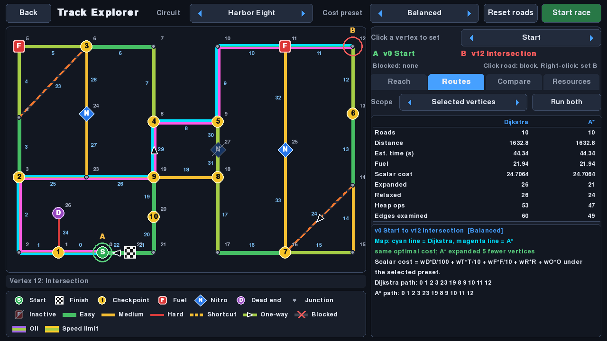
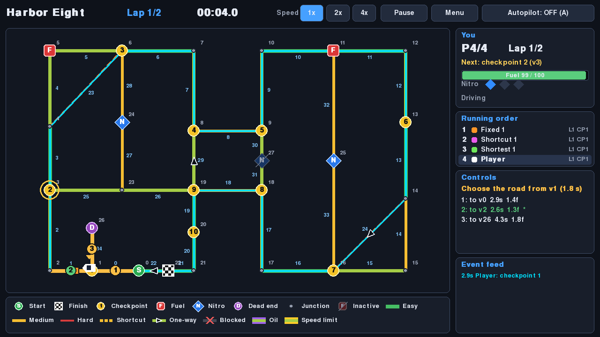
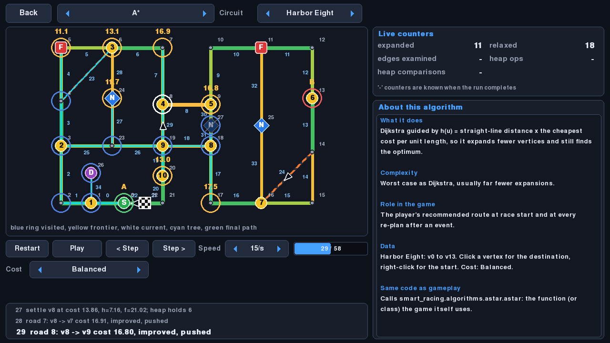
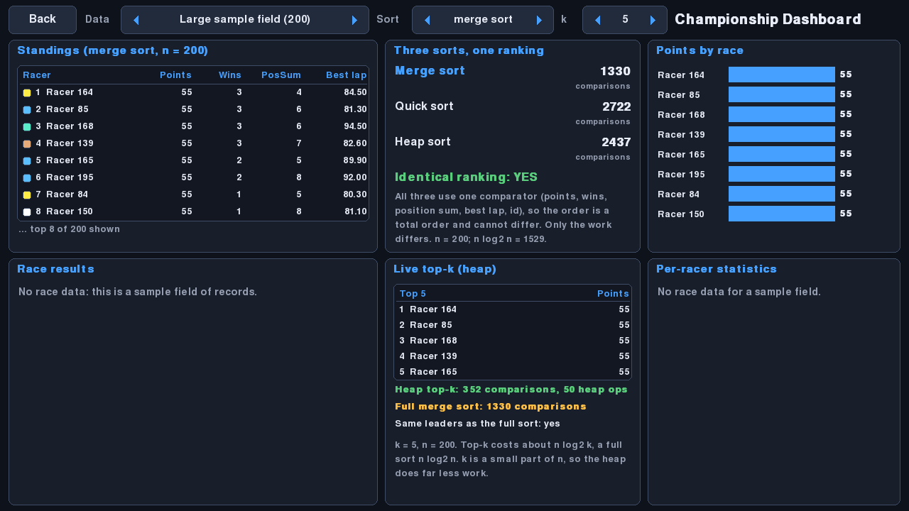
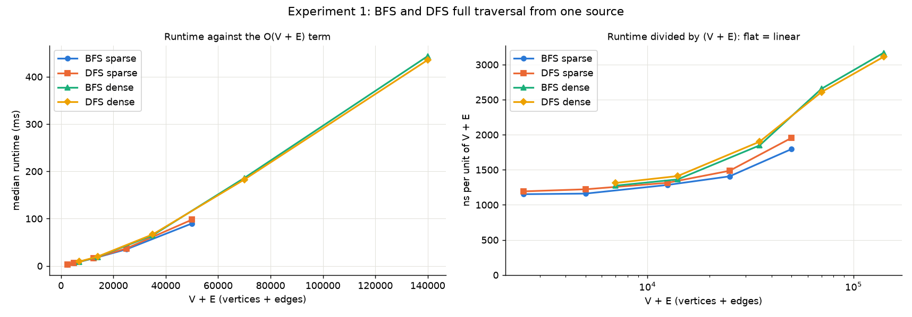
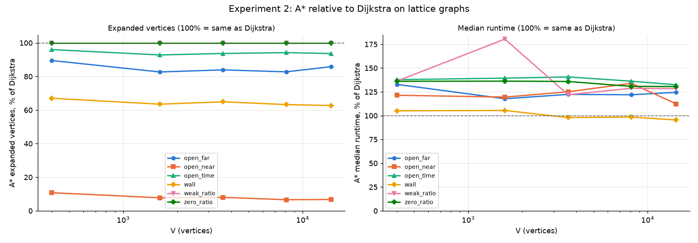
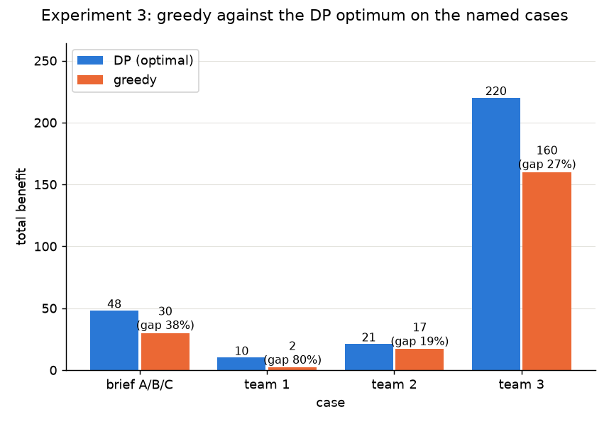
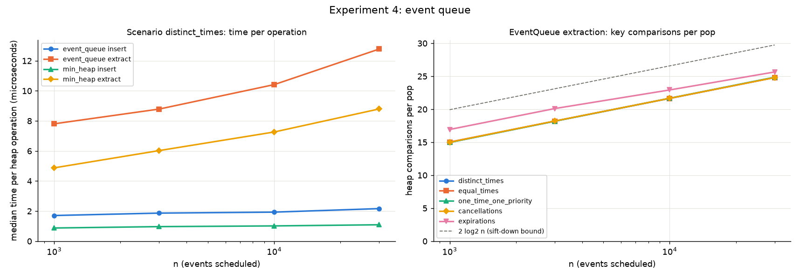
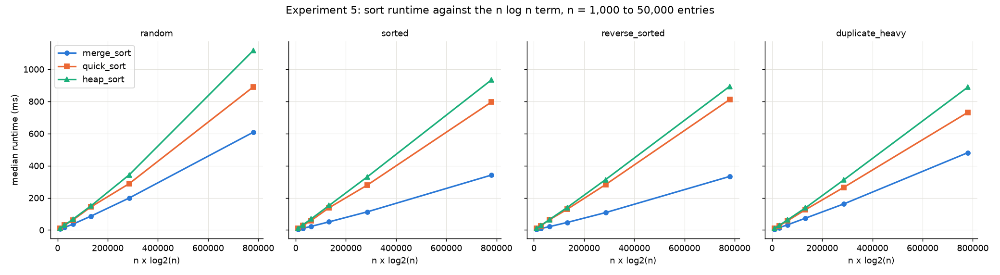
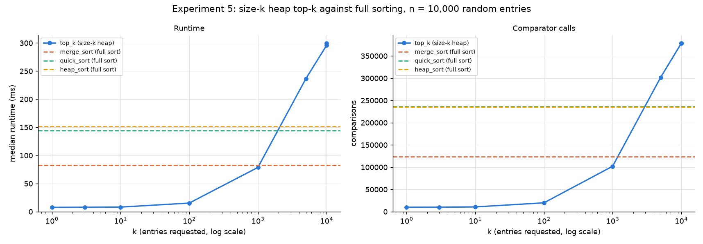

**Course:** Design and Analysis of Algorithms  **Section:** X
**Group members:** 24I-XXXX Name, 24I-YYYY Name, 24I-ZZZZ Name *(placeholders: replace before submission)*
**Deadline:** 05 December 2026

# 1. Title and summary

Smart Racing Championship is a 2D top-down racing game in Python (pygame-ce) whose gameplay is driven by twelve hand-written algorithms. The assessment focus is modelling, algorithm integration, complexity, testing and measured results. No machine learning is used; opponents follow fixed deterministic rules.

# 2. Introduction and problem statement

Circuits are road networks with checkpoints, shortcuts, fuel stations, nitro pickups and dynamic events. The player plans routes, manages fuel and nitro, reacts to road closures, and competes against three deterministic opponents over a three-race championship. Every mandatory algorithm has a functional role in the running game, and the Algorithm Lab replays the same implementations gameplay calls.

# 3. System architecture and game flow

```
ui (pygame)  ->  engine (headless)  ->  algorithms  ->  core
 screens          race, routing,         bfs dfs dijkstra   graph, models,
 lab registry     resources, opponents   astar knapsack      cost
                  events, championship   refuel mst
 tracks: loader, validator, generator    backtracking sorting topk heap
```

`core`, `algorithms` and `engine` never import pygame, so a full championship runs headless and deterministically (fixed tick `SIM_DT = 0.05 s`, seeded randomness, id-based tie-breaks). Flow: Main Menu -> Championship / Quick Race / Track Explorer / Algorithm Lab / Dashboard / Track Generator. In a championship: briefing -> plan (BFS/DFS explore, Dijkstra/A* compare, DP/greedy recommend) -> race (event heap, rerouting) -> results -> standings (sorting, top-k) -> repeat for three circuits -> champion.

The five required screens are: Main Menu, Track Explorer / Route Planner, Racing Screen, Algorithm Lab, Championship Dashboard. A Track Generator screen covers Challenge 1.

{width=95%}

{width=95%}

{width=95%}

{width=95%}

# 4. Data models, assumptions, cost and rules

**Graph.** `TrackGraph` uses adjacency lists: O(V+E) memory and efficient neighbour iteration for sparse roads. Vertices: id, x, y, type, checkpoint order, active. Edges: id, endpoints, distance, base time, fuel cost, difficulty 1 to 5, shortcut flag, directed flag, and a set of independent temporary effects. Blocking, unblocking and station activation are in-place updates. Blocked edges and wrong-way one-way edges are never yielded by `neighbors`. Overlapping effects (block, oil, speed restriction) are stored per event id: difficulty bump is the maximum, time multiplier the strictest, and expiry of one effect never removes another.

**Cost.** `cost(e) = wD*D/Dref + wT*T/Tref + wF*F/Fref + wR*R + wO*O` with `Dref=100, Tref=10, Fref=10`, `R=(difficulty-1)/4`, `O` the obstacle penalty in [0,1]. The displayed cost is exactly the cost optimised.

| Preset | wD | wT | wF | wR | wO |
|---|---|---|---|---|---|
| Balanced | 1 | 1 | 1 | 1 | 1 |
| Speed | 0.5 | 3 | 0.25 | 0.5 | 0.5 |
| Economy | 0.5 | 0.5 | 3 | 0.5 | 0.5 |
| Safety | 0.5 | 0.5 | 0.5 | 3 | 3 |

**Rules (frozen in `docs/SPEC.md`, `docs/RULES.md`).** Tank 100, fuel per edge = `fuelCost * (1 + 0.1*(difficulty-1))`; stations sell up to 40 units for a fixed 3 s stop; nitro max 3 charges, 1.5x speed for 4 s with 2x fuel; laps need all checkpoints in order and a finish crossing; ties by lower racer id; unfinished racers rank by laps, checkpoints, time, id and earn no points. Points 25, 18, 15, 12, 10, 8, 6, 4, 2, 1 plus a fastest-lap bonus of 1 for finishers. Championship comparator: points, wins, lower position sum, lower best lap, lower racer id (single function `championship_less`). Recovery policy: re-plan, wait, DNF after 60 s waiting or immediately when no pending event can change the graph.

**Opponents.** Fixed Route (stored main route and detour), Shortcut (uses a designated shortcut when open, else main route), Shortest Distance (recomputes minimum distance). Each refuels when below 25% fuel or when fuel will not reach the next station; documented in `docs/RULES.md` as a deliberate extension because the bare 25% rule stranded cars.

**Circuits.** Harbor Eight (28 vertices, 35 edges), Grand Ring (25/33), Serpent Pass (31/38); each has 10 ordered checkpoints, 2 shortcuts, a cycle, a dead end, one-way roads, fuel stations and nitro pickups.

# 5. Algorithm design

Each function returns a result dataclass with operation counters and accepts an optional `observer` callback; the Lab replays those steps. Supporting data structures (MinHeap, union-find, queue) are distinguished from algorithms.

| # | Algorithm | Pseudocode (core idea) | Time / space |
|---|---|---|---|
| 1 | BFS | queue; pop u; for each traversable neighbour v unseen: parent[v]=u, push | O(V+E) / O(V) |
| 2 | DFS | explicit stack; discovery order, back-edge detection for cycles, components, dead-end analysis; bounded path enumeration (max 10 routes, 40 edges) | O(V+E) / O(V); path enumeration exponential, hence limits |
| 3 | Dijkstra | heap on (dist, id); pop, skip stale, relax out-edges with non-negative cost | O((V+E) log V) / O(V) |
| 4 | A* | Dijkstra with key g+h, h = straight-line distance x min cost-per-distance ratio | worst case as Dijkstra |
| 5 | DP | knapsack `dp[i][b] = max(dp[i-1][b], dp[i-1][b-c_i]+v_i)` with traceback; refuel DP over (stop, fuel) minimising stop time | O(mB), O(mC^2) |
| 6 | Greedy | zero-cost positive-benefit first, then by v/c descending, ties by id; not optimal | O(m log m) |
| 7 | Backtracking | assign variables in order, reject inconsistent values, optional prune hook, node limit | exponential worst case |
| 8 | Kruskal | merge-sort edges by (weight, id); union-find accepts edge if endpoints differ | O(E log E) |
| 9 | Heap / PQ | binary min-heap keyed (time, priority, sequence); size-k heap for top-k | O(log n) push/pop, O(n log k) top-k |
| 10 | Merge sort | bottom-up, stable | O(n log n) / O(n) |
| 11 | Quick sort | median-of-three at seeded pseudo-random positions, three-way partition, explicit stack | O(n log n) avg, O(n^2) worst |
| 12 | Heap sort | build heap, extract | O(n log n), in place, not stable |

**Pseudocode.**

1. **BFS(G, s, t):** (1) dist[s]=0, enqueue s. (2) While the queue is non-empty, dequeue u; stop if u==t. (3) For each traversable edge (u,v) with v unseen: dist[v]=dist[u]+1, parent[v]=(u,e), enqueue v. (4) Rebuild the path from parent. O(V+E).
2. **DFS (explicit stack):** (1) Push s and mark discovery. (2) For each neighbour v of the top vertex: if unseen, set parent and push; else if v is not reached by the parent edge, record a back edge (cycle). (3) Components: restart from every unvisited vertex. (4) Dead ends: DFS over (arrival edge, vertex) states from Start and a reverse search from Finish; a non-mandatory reachable vertex with no arrival state that reaches Finish is a dead end. (5) `enumerate_paths`: depth-first over simple paths, cut at `max_routes` and `max_length`.
3. **Dijkstra(G, s, cost):** (1) dist[s]=0, push (0,s). (2) Pop (d,u); skip if d>dist[u]. (3) For each open edge e=(u,v): if d+cost(e)<dist[v], update dist and parent, push. (4) Stop when the target is closed. O((V+E) log V), cost >= 0.
4. **A\*:** (1) r = min over open edges of cost(e)/straight_line(e); h(v)=straight_line(v,t)*r. (2) Run Dijkstra with key g+h, ties by vertex id. (3) h is admissible and consistent, so a closed vertex is never reopened; if r=0 this is Dijkstra.
5. **Knapsack DP:** (1) dp[0][b]=0. (2) For i=1..m, b=0..B: dp[i][b]=dp[i-1][b]; if c_i<=b and dp[i-1][b-c_i]+v_i is strictly larger, take it. (3) Traceback from b=B: for i=m..1, if dp[i][b]!=dp[i-1][b], select i and b-=c_i. O(mB). The refuel DP is written out below.
6. **Greedy:** (1) Drop items with benefit <= 0. (2) Take zero-cost positive-benefit items first, in id order. (3) Sort the rest by v/c descending (cross-multiplied), ties by lower id. (4) Scan in order; take an item if it fits, otherwise skip it and continue. O(m log m).
7. **Backtracking(i):** (1) If i==n, return the solution. (2) For each value x in domain(i): if consistent(x) and not pruned, assign it and recurse on i+1; return if solved. (3) Undo and try the next value. (4) Stop at the node limit. Exponential worst case.
8. **Kruskal:** (1) Merge-sort edges by (weight, id). (2) For each edge (u,v): if find(u)!=find(v), union and keep it. (3) If fewer than V-1 edges were kept, report a forest. O(E log E).
9. **Event queue (MinHeap, key (time, priority, seq)):** schedule pushes with the next sequence number; cancel sets `cancelled=True`; `pop_due(now)` pops while top time <= now, skips cancelled entries, validates the target and state (apply or log as rejected) and schedules an expiry for temporary effects; the engine then re-plans once per affected racer. Top-k: a size-k heap whose root is the worst kept entry is replaced when a better entry arrives, O(n log k).
10. **Merge sort:** (1) Treat runs of width 1 as sorted. (2) Merge adjacent runs, taking from the left run on ties (stable). (3) Double the width until it reaches n. O(n log n), O(n) extra.
11. **Quick sort (explicit stack):** (1) Pivot = median of three elements at seeded pseudo-random positions. (2) Three-way partition `< | == | >`. (3) Push the two outer ranges. Average O(n log n), worst case O(n^2).
12. **Heap sort:** (1) Build a heap in place bottom-up. (2) Swap root with the last element, shrink the heap, sift down. (3) Repeat n-1 times. O(n log n), in place, not stable.

**Cost normalisation rationale.** Each term is divided by a reference so it is dimensionless (`D/100`, `T/10`, `F/10`); `R=(difficulty-1)/4` and `O` already lie in [0,1]. The references are round numbers near the upper range of the built-in edges (distance 57 to 316, median 177; time 1.3 to 9.6, median 4.2; fuel 0.8 to 13, median 2.7), so no term is switched off by its unit. Balanced uses weight 1 everywhere; the presets tilt it (Speed wT=3, wF=0.25; Economy wF=3; Safety wR=wO=3). All weights are >= 0, so edge costs are >= 0 and Dijkstra applies. The displayed cost is computed by the same function the search minimises. Limit: the winning route depends on the references and weights, and a weighted sum can miss Pareto-optimal routes.

**Knapsack DP (Problem A).** Items i=1..m with integer cost c_i >= 0 (extra out-and-back detour time in tenths of a second, rounded up) and benefit v_i; budget B = 6 s = 60 units. Only detour time is budgeted; nitro capacity is applied before the knapsack and fuel is checked afterwards by the refuel DP, which drops the thirstiest loop while the plan is infeasible. *State:* `dp[i][b]` = best benefit using the first i items with total cost <= b. *Base:* `dp[0][b]=0`; for positive costs `dp[i][0]=0`. *Recurrence:* `dp[i][b]=max(dp[i-1][b], dp[i-1][b-c_i]+v_i)` if c_i <= b, else `dp[i-1][b]`; an item is taken only on strict improvement (deterministic). *Reconstruction:* from (m,B), item i was taken iff `dp[i][b]!=dp[i-1][b]`, then b-=c_i. *Complexity:* O(mB) time and space (O(B) if only the value is needed), pseudo-polynomial in the numeric budget. Zero-cost items fit every column; greedy takes zero-cost positive-benefit items first.

**Refuel DP (Problem B).** A fixed route has stops 0..m-1 plus destination m; d_j is the fuel from stop j to j+1; C is the tank capacity. The fuel unit is 1/`FUEL_SCALE` = 0.1: demands round up, start fuel and capacity round down, and purchases are whole units, so a DP-feasible plan is feasible in the engine (the state space is 10x larger than with whole units). *State:* `dp[j][f]` = minimum stop time to arrive at stop j with f units. *Base:* `dp[0][start_fuel]=0`; other states are unreachable and skipped. *Transition* at an available stop j: buy a with 0 <= a <= min(40, C-f); if f+a >= d_j, `dp[j+1][f+a-d_j] = min(., dp[j][f] + (3 s if a>0 else 0))`; at a non-station or the destination only a=0. *Answer:* the destination state with least stop time, ties by most fuel; infeasible if no state reaches m, and the first leg no state can cover is reported. *Reconstruction:* a parent (f, a) is stored per state and followed back; `replay_plan` re-checks the rules independently. *Complexity:* O(m * F * P) with F = C*scale+1 fuel states and P = 41 purchase options (the brief's O(mC^2) in scaled units); space O(mF).

**Backtracking: worst case and pruning.** With n variables and domain size d, up to O(d^n) assignments can be tried; placing checkpoints, stations and pickups on a loop is exponential without pruning. The search is bounded by a node limit and the 20-attempt retry limit, so an over-hard candidate is retried or rejected rather than hanging. Each pruning rule below is a necessary condition of a valid track, not a preference, so it never discards a valid layout: (1) maximum degree: a shortcut endpoint already at `GEN_MAX_DEGREE` roads is refused; (2) station spacing: stations must be at least `GEN_STATION_MIN_GAP` loop positions apart in both directions; (3) obstacle spacing: two obstacle sites may not share an endpoint; (4) critical bridge: no closure is scripted on a bridge, found by blocking the road and counting DFS components, since it would cut racers off; (5) shortcut separation: the second shortcut starts after the first ends, removing symmetric orderings; (6) checkpoint order and room: checkpoint k goes after k-1, never on a station or shortcut-cut vertex, and a branch is cut when fewer free later positions remain than checkpoints left to place; (7) nitro spacing: pickups at least `GEN_NITRO_MIN_HOPS` apart and off mandatory, station and dead-end vertices; (8) loop closure: a branch is cut when the start vertex is more roads away than slots remain (BFS hops are a lower bound). The counters `nodes`, `prunes` and `backtracks` are reported.

**Correctness reasoning.** BFS dequeues vertices in non-decreasing edge-count order, so the first discovery of a vertex is by a minimum-edge path (it ignores weights: direct S-T of length 10 beats S-A-B-T of length 6 in edges but not in distance). Dijkstra's closed-set invariant holds because costs are non-negative. The A* heuristic multiplies straight-line distance by the minimum cost-per-distance ratio over open edges; by the triangle inequality it is admissible and consistent, so closed vertices are never reopened and the cost equals Dijkstra's (verified on 400 random instances). Knapsack DP is checked against exhaustive search on 200 random instances in the unit tests and 500 in the Experiment 3 sweep; greedy is shown suboptimal (the brief's A/B/C example gives 30 versus 48, plus three further cases (two original team cases and the textbook 10/20/30 case)). Event order is by `(trigger_time, priority, insertion_sequence)` with lazy deletion for cancellation: simple and O(1) to cancel, at the cost of cancelled entries staying in memory until popped. Prim vs Kruskal: Kruskal implemented; the candidate graph must be connected, otherwise the result is a forest and is reported as such.

**Generation pipeline (Challenge 1).** Jittered lattice vertices, candidate roads, Kruskal MST, extra edges, a backtracking search for a closed main loop, one-way roads added after the MST, backtracking placement of checkpoints, stations, pickups and obstacles under documented pruning rules, then validation with up to 20 retries. Seed 29 shows attempt 1 rejected for fuel infeasibility and attempt 2 accepted.

# 6. Integration: where each algorithm runs in gameplay

| # | Algorithm | Call sites |
|---|---|---|
| 1 | BFS | validator (ordered reachability, lap return), generator, Track Explorer, Lab |
| 2 | DFS | validator (cycle, dead end, two routes), generator (bridges), Explorer, Lab |
| 3 | Dijkstra | Opponent 3 routes, nearest-station recovery, pickup detours, validator, Explorer |
| 4 | A* | player route at start and every re-plan, preset comparison, Explorer |
| 5 | DP | pickup recommendation (knapsack), refuel plan at stations, validator fuel check |
| 6 | Greedy | pickup planner. Quick Race has a 'Pickup planner' setting (DP, greedy, none) that the player's autopilot applies; the Racing Screen shows the DP and greedy benefits of the current plan side by side, and the Explorer resource tab shows the same comparison before the race |
| 7 | Backtracking | track generator (main loop, placement) |
| 8 | Kruskal | track generator backbone |
| 9 | Heap | event queue in the race loop, search frontiers, live top-k |
| 10 | Merge sort | championship standings (default), live running order |
| 11 | Quick sort | selectable standings method on Dashboard |
| 12 | Heap sort | selectable standings method on Dashboard |

The Algorithm Lab obtains every algorithm from `smart_racing.ui.lab_registry`, which holds the same function objects gameplay imports. Test `test_registry_is_the_gameplay_functions` asserts identity, and `test_lab_counters_equal_direct_call` asserts the Lab's counters equal a direct call. BFS and DFS are not called inside the per-tick race loop; they run in the validator, generator, Explorer, Lab and the championship briefing (BFS: reachable checkpoints and fewest roads Start to Finish; DFS: cycle and dead ends of the circuit about to be raced).

# 7. Testing

The full suite has 383 passing tests (`.venv/bin/pytest -q`). Coverage mapped to Project.md 9.1:

| Area | Test files |
|---|---|
| Graph: single vertex, disconnected, cyclic, branching, dead end, directed, undirected | `test_graph.py`, `test_bfs_dfs.py` |
| Routing: source=target, unreachable, blocked edge, equal cost, zero weight, changes mid-race | `test_shortest_path.py`, `test_routing_resources.py`, `test_race.py` |
| Resources: insufficient fuel, full tank, unavailable station, capacity, zero-cost pickup, infeasible plan | `test_refuel.py`, `test_knapsack.py`, `test_routing_resources.py` |
| Events: simultaneous, ties, cancellation, expiry, missing target, overlap | `test_events.py`, `test_heap.py` |
| Sorting: empty, singleton, random, sorted, reversed, duplicates, same comparator, id tie-break | `test_sorting_topk.py` |
| Tracks and generator: validator rejections, minimum counts, seeds | `test_tracks.py`, `test_generator.py`, `test_mst.py`, `test_backtracking.py` |
| Integration: full race, laps, ordered checkpoints, DNF, closure, championship | `test_race.py`, `test_championship.py` |
| GUI: every screen, full championship from menu, registry identity | `test_ui_smoke.py`, `test_ui_phase6.py` |
| Experiments: correctness conditions | `test_experiments.py` |

Dijkstra and A* are checked against brute force on 40 seeded random graphs; DP against exhaustive search; Kruskal weight against brute-force MST on 150 graphs; the three sorts agree on every input shape, including 100k elements with a low recursion limit.

# 8. Experiments

Five studies follow the required format: objective, environment, input generation, dataset sizes, procedure, metrics, results, interpretation, limitations, conclusion. Full detail, tables and raw-data pointers are in **Appendix A** (generated from the CSV files in `experiments/results/`). Headline findings from the final run:

- **Exp 1 BFS/DFS:** counters are exactly linear (V vertices visited, 2E adjacency entries examined); measured runtime grew faster than V+E on the large inputs, so the measurements do not by themselves confirm linear time; theory gives O(V+E).
- **Exp 2 Dijkstra/A\*:** equal costs in all 50 timed configurations and 400 sweep instances; A* expanded fewer vertices in 40 timed configurations, equal in 10, more in none; in wall time A* was usually slower on the small real circuits (25 to 31 vertices).
- **Exp 3 DP/greedy:** DP equals exhaustive search in all instances; greedy strictly worse on the brief's example (30 vs 48) and on three team cases; greedy suboptimal in 151 of 500 random instances.
- **Exp 4 event queue:** pop order correct for ties, cancellations and expirations; 15.0 comparisons per pop at n=1,000 and 24.8 at n=30,000.
- **Exp 5 sorting/top-k:** all sorts agree with the common comparator; merge sort fastest on every shape (609 ms at n=50,000 random vs 891 ms quick and 1,117 ms heap); size-k top-k beats full sort for small k and loses for k near n.

{width=70%}

{width=70%}

{width=70%}

{width=70%}

{width=70%}

{width=70%}

# 9. Limitations, advanced challenges, future work

**Advanced challenges (all three completed).** Challenge 1 automatic generation: Track Generator screen and `tracks/generator.py`, with rejected candidates and reasons (seed 29). Challenge 2 multi-objective planning: Explorer Compare tab with the four presets, weights table and the limitation that a single weighted scalar depends on arbitrary weights and normalisation and can miss Pareto-optimal routes. Challenge 3 live analytics: heap-based top-k in the Dashboard and Racing Screen compared with full sorting.

**Limitations.** A* is slower than Dijkstra in wall time on the small circuits despite expanding fewer vertices. Greedy is not optimal. Generated tracks are valid but less race-like than the hand-built ones. The generator view draws only the accepted attempt. The Lab's heap-sort view shows the unsorted part in input order because the observer does not record the heap array. The Lab's backtracking example is station spacing rather than the generator's own placement problem. Settings are not persisted. Opponent cars are distinguished by colour only. Timings come from one machine and Python; they are not a general statement about the algorithms.

**Future work.** Per-attempt drawings in the generator, persistent settings, an on-car label, and a compiled implementation for larger timing ranges.

# 10. Conclusion

All twelve mandatory algorithm families are implemented by hand, integrated into a deterministic playable game, visualised through the same code in the Algorithm Lab, covered by 383 tests, and measured in five reproducible experiments. All three advanced challenges are included.

**References and acknowledgements.** pygame-ce (GUI), matplotlib (charts), pytest (tests), pandoc and Chrome (report export), and course lecture material. No external code was copied; no assets were used (all graphics are drawn with pygame primitives).

# Compliance checklist (Project.md sections 1 to 9)

| Requirement | Where satisfied |
|---|---|
| 3 playable circuits, 10 checkpoints, 2 shortcuts, cycle, dead end, one-way | `smart_racing/tracks/data/*.json`, `test_tracks.py` |
| 1 human + at least 3 opponents, deterministic | `engine/opponents.py`, `test_race.py` |
| 5 GUI screens | `ui/screens/` (menu, explorer, race, lab, dashboard) |
| 12 algorithm families | `smart_racing/algorithms/`, section 6 |
| Lab uses gameplay code | `ui/lab_registry.py`, `test_ui_phase6.py` |
| Cost normalisation, presets, different routes per preset | `core/cost.py`, section 4, `test_tracks.py` |
| Event heap, lazy cancel, overlapping effects | `engine/events.py`, `test_events.py` |
| Scoring and single comparator | `engine/championship.py`, `algorithms/sorting.py` |
| 5 experiments with raw data | `experiments/results/`, Appendix A |
| 3 advanced challenges | section 9 |
| README, report PDF, ZIP | `README.md`, `report/report.pdf`, `scripts/package.py` |

\newpage

# Appendix A. Experimental results (generated)

*The text below is generated by `python -m smart_racing.experiments.run_all` from the raw CSV files and is included unmodified.*

